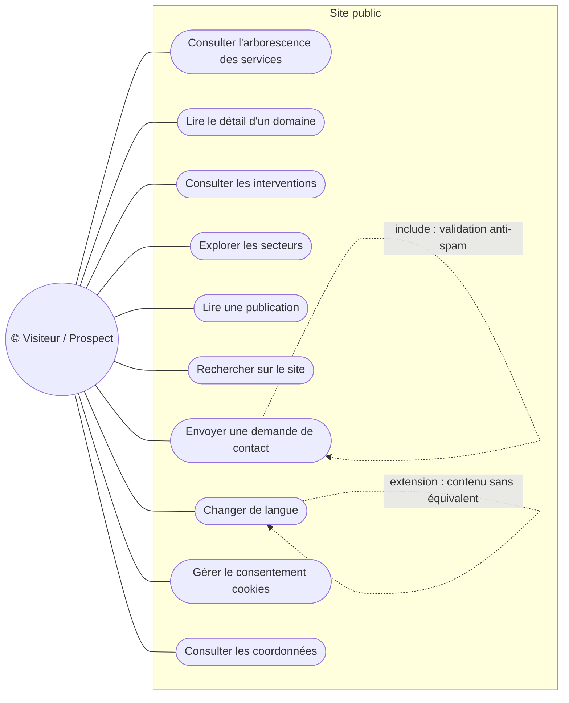
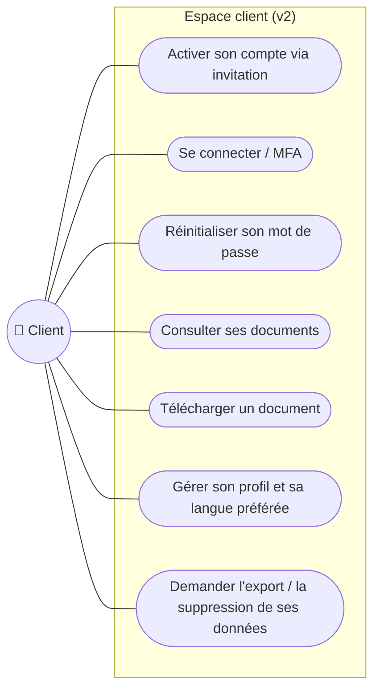
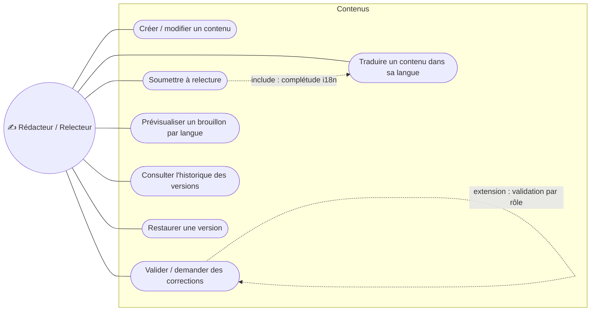
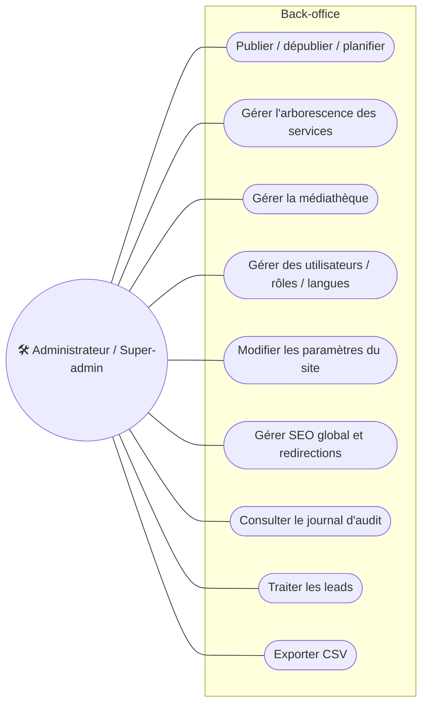
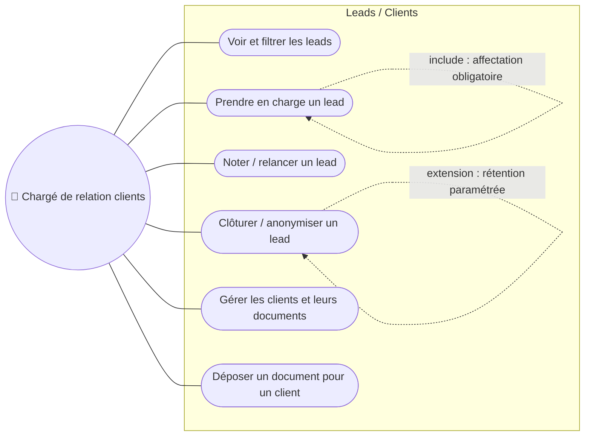
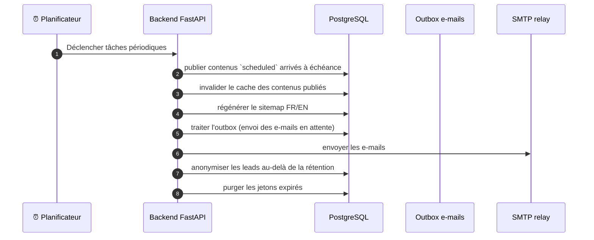

# 03 · Cas d'usage et user stories

> 🟡 **Statut : M1 — à faire valider.**
> Chaque user story porte : ID `US-xxx`, acteur, formulation, priorité
> MoSCoW, critères Given/When/Then, exigences liées (`EF-`, page
> [02](02-exigences.md)) et scénarios (`SC-`, page [04](04-scenarios.md),
> détaillés au M4). Les cas d'usage `UC-xxx` sont regroupés par acteur et
> visualisés en diagrammes Mermaid.

## 1. Acteurs

| Acteur | Description | Rôles backend associés |
|---|---|---|
| Visiteur | Tout internaute, FR ou EN, sans compte | — (public) |
| Prospect | Visiteur intéressé, qui peut envoyer une demande de contact | — (public) |
| Client (v2) | Personne physique ou utilisateur d'un compte organisation, invité par le cabinet (Q-005) | `client` |
| Rédacteur | Utilisateur back-office qui crée/modifie du contenu dans une (**ou plusieurs**) langue(s) autorisée(s) | `editor` restreint |
| Relecteur | Valide le contenu avant publication | `reviewer` |
| Administrateur | Gère contenus, médias, leads, utilisateurs | `admin` |
| Super-admin | Gère paramètres globaux, langues, sauvegardes, tout effacer | `super_admin` |
| Chargé de relation clients | Traite les leads, gère clients et documents (v2) | `crm` |
| Système | Triggers automatisés : outbox e-mails, planificateur, sitemap, nettoyage | — |

H-001 (reformulée) : au démarrage, une seule personne (fondateur) occupe
de facto tous les rôles — **le modèle et le back-office supportent dès la v1
plusieurs utilisateurs, plusieurs rôles et des permissions par langue**.

## 2. Diagrammes de cas d'usage

### 2.1 Visiteur / Prospect

### 2.2 Client (Espace client, v2 — périmètre Q-005)

### 2.3 Rédacteur / Relecteur

### 2.4 Administrateur / Super-admin

### 2.5 Chargé de relation clients

### 2.6 Système

## 3. Liste des cas d'usage

| ID | Cas d'usage | Acteur(s) | Priorité | Exigences |
|---|---|---|---|---|
| UC-001…UC-010 | Consultation du site public et contact | Visiteur / Prospect | Must | EF-101…EF-108, EF-202, EF-301 |
| UC-020…UC-026 | Espace client | Client | Must (v2) | EF-401…EF-405 |
| UC-030…UC-036 | Rédaction, relecture, traduction | Rédacteur / Relecteur | Must | EF-503, EF-504, EF-505, EF-514, EF-601 |
| UC-040…UC-048 | Publication, arborescence, médias, users, SEO, audit | Admin / Super-admin | Must / Should | EF-506, EF-508…EF-513, EF-602, EF-604, EF-704, EF-901 |
| UC-050…UC-055 | Leads et clients | Chargé de relation clients | Must / Should | EF-304, EF-305, EF-403 |
| UC-060…UC-065 | Tâches automatiques | Système | Must / Should | EF-306, EF-701, EF-903, ENF-701/702 |

## 4. User stories avec critères d'acceptation

Les 15 stories ci-dessous couvrent les flux critiques ; de nouvelles
stories s'ajouteront au M4 avec le catalogue de scénarios.

### US-001 — Navigation de l'arborescence des services (`Must`)

> **Visiteur** : *En tant que visiteur, je veux naviguer l'offre de services
> du niveau famille jusqu'à la prestation, dans ma langue, pour comprendre
> ce que fait le cabinet.*

**Liens** : EF-101, EF-102 · SC-101 · Écran : pages `Services` du frontend.

| Step | Critère (Given/When/Then) |
|---|---|
| 1 | **Given** je suis sur `/fr/services` **when** la page se charge **then** 2 familles, 10 domaines, 20 groupes, 94 prestations sont navigables |
| 2 | **Given** je consulte un domaine **when** j'ouvre la page **then** l'intro, les groupes et les prestations s'affichent, avec navigation « précédent/suivant » correcte |
| 3 | **Given** je passe en EN **when** le contenu équivalent existe **then** les slugs traduits (`support`, `payroll`…) sont utilisés sans erreur 404 |

### US-002 — Recherche multi-langue (`Must`)

> **Visiteur** : *Je veux chercher une prestation par mot-clé, en FR ou EN,
> pour trouver rapidement le bon service.*

**Liens** : EF-201…EF-204 · SC-201…SC-203.

- **Given** je tape « paye » en FR et « payroll » en EN **when** je soumets les deux requêtes **then** les résultats incluent
  le domaine « Traitement de la Paye » ; les résultats FR et EN sont clairement distingués (champ `is_fallback` visible).
- **Given** une requête sans résultat **when** la recherche répond **then** code `200` + suggestions de reformulation, jamais d'erreur 500.
- **Given** requête avec accents/caractères spéciaux **when** retour **then**
  correspondance insensible à la casse/accents correcte.

### US-003 — Lecture d'une publication dans ma langue (`Must`)

*Liens* : EF-105, EF-603 · SC-105…107.

- **Given** un article existe en FR mais uniquement en brouillon EN **when**
  je visite la version EN **then** repli FR + bandeau et `is_fallback: true`.
- **Given** un article `draft` **when** requête publique **then** 404.

### US-004 — Contact depuis le formulaire (`Must`)

> **Prospect** : *Je veux laisser une demande de contact et être-mail de
> confirmation, sachant que le cabinet me répondra.*

**Liens** : EF-301…EF-303, EF-306 · SC-301…303, SC-312.

- **Given** un formulaire valide **when** je soumet **then** confirmation affichée ; le lead est créé (`status=new`, `lang=fr` ou `en` selon la langue du formulaire), pas de doublon.
- **Given** soumission d'un bot (honeypot rempli) **when** le serveur reçoit **then** rejet silencieux, aucune création de lead.
- **Given** dépassement du rate limit **when** soumission **then** réponse 429 avec `Retry-After`.

*Note : la notification e-mail au cabinet est Must ; l'envoi d'un accusé de réception au prospect reste Should (voir SC-312 et page 08).*

### US-005 — Éditer l'offre de services en FR et EN (`Must`)

> **Rédacteur FR (ou admin)** : *Je veux créer/modifier familles, domaines,
> groupes, prestations — l'intro, les titres aussi par langue — pour
> garder le site à jour.*

**Liens** : EF-501…EF-503, EF-507, EF-508, EF-601, EF-604 · SC-520, SC-530.

- **Given** j'édite un domaine **when** je déplace un groupe via la liste réordonnable **then** l'ordre persiste, les liens internes suivent, aucune 404 publique.
- **Given** je change le slug FR d'un groupe déjà publié **when** je publie **then**
  une redirection 301 est créée automatiquement (SC-530).
- **Given** je ne bénéficie pas de droits EN **when** j'essaie d'éditer la version
  EN **then** action refusée en 403 avec un message explicite (permissions par
  langue, H-001/EF-502).

### US-006 — Workflow éditorial de bout en bout (`Must`)

> **Relecteur** : *Je veux relire une soumission, demander des corrections ou
> l'approbation, pour que la publication n'émane pas d'un rédacteur seul.*

**Liens** : EF-503 · SC-520 · workflow détaillé au M2 (page 05).

- **Given** un contenu en statut `in_review` **when** je valide **then** statut `approved` ; la publication reste réservée à un rôle disposant du droit `publish`.
- **Given** je refuse **when** je renvoie **then** le statut revient à `draft` avec un motif consigné dans l'historique versionné.

### US-007 — Publication planifiée + dépublication (`Must`)

**Liens** : EF-506 · SC-523.

- **Given** un contenu `approved` planifié à une date/heure **when** l'échéance arrive
  **then** le contenu devient `published` (± 1 min), le cache est invalidé,
  le sitemap régénéré.
- **Given** dépublication **when** confirmée **then** la page sort du sitemap et
  répond 301 vers la page parente (H-007 : à confirmer).

### US-008 — Modifier les coordonnées du cabinet (`Must`)

> **Admin** : *Je veux modifier téléphone, e-mail, adresse, réseaux depuis les
> paramètres, pour que toute mise à jour soit immédiate sans intervention
> technique.*

**Liens** : EF-106, EF-510 · SC-110, SC-550.

- **Given** les paramètres actuels **when** je modifie le numéro mobile et enregistre **then** le frontend affiche le nouveau numéro après invalidation du cache (≤ 60 s).
- **Given** le besoin de revenir à l'ancienne valeur **when** j'ouvre l'historique **then** les valeurs antérieures sont restaurables depuis les versions.

### US-009 — Gestion d'une langue (`Must`)

> **Super-admin** : *Je veux ajouter/activer/désactiver une langue dans le
> back-office, pour permettre l'ouverture d'une édition à un autre public.*

**Liens** : EF-601, EF-602, EF-605 · SC-601…603, SC-605 page 07.

- **Given** langue « Wolof (wo, LTR) » est créée **when** activée **then** aucune
  migration BD ; les entités éditoriales apparaissent « à traduire ».
- **Given** la langue est désactivée **when** un visiteur demandait cette langue
  **then** repli vers la langue par défaut + `is_fallback`.

### US-010 — Médiathèque (`Must`/`Should`)

**Liens** : EF-801…EF-803 · SC-801…803.

- **Given** un fichier PDF ren Universität exécuté déguisé en .png **when** upload
  **then** rejet avec message i18n.
- **Given** suppression d'un média référencé **when** confirmation **then** refus
  enregistré en base avec les contenus qui le référencent.

### US-011 — Import initial du contenu (`Must`)

> **Développeur / Admin** : *Je veux que le contenu actuel du frontend migré en
> base et vérifié à l'identique (seed).*

**Liens** : EF-101, ENF-801 · page 13.

- **Given** `content.data.ts` **when** le seed s'exécute **then** parité
  automatisée : 2 familles, 10 domaines, 20 groupes, 94 prestations, slugs FR/EN
  identiques aux `PAGE_SLUGS`.

### US-012 — Journal d'audit (`Must`)

**Liens** : EF-901 · SC-901.

- **Given** toute action d'écriture **when** interrogation du journal **then**
  acteur, action, entité, avant/après, IP, horodatage UTC visibles, filtrable,
  non modifiable.

### US-013 — Activation d'un compte client (`Must`, v2)

**Liens** : EF-401, EF-402 · SC-401/402.

- **Given** une invitation envoyée **when** le client clique le lien signé,
  définit son mot de passe (+ MFA optionnel) **then** le compte devient actif.
- **Given** un visiteur inconnu **when** il cherche à s'inscrire **then**
  impossible (pas de route d'inscription publique).

### US-014 — Dépôt / téléchargement d'un document client (`Must`, v2)

**Liens** : EF-403 · SC-404 (IDOR impossible).

- **Given** le chargé de relation clients dépose un PDF **when** terminé **then**
  une notification e-mail est envoyée au(x) utilisateur(s) du compte.
- **Given** un client A authentifié **when** il tente de télécharger le document
  du client B (IDOR) **then** 404/403, tentative journalisée.

### US-015 — Droits RGPD/CDP (`Must`, v2, à valider juridiquement)

**Liens** : EF-405, EF-1001…1003 · SC-406, SC-1001…1003.

- **Given** un client demande l'export de ses données **when** la demande est
  traitée **then** archive téléchargeable, lisible par machine, SLA 30 jours,
  journalisé.
- **Given** suppression demandée **when** validée **then** anonymisation/rétention
  conformément aux paramètres, audit conservé (A VALIDER JURIDIQUEMENT).

## 5. Matrice acteurs × rôles × langues (H-001)

| Action | Rédacteur FR seul | Relecteur | Admin | Super-admin | CRM |
|---|---|---|---|---|---|
| Créer/éditer contenu (sa langue) | ✅ | ✅ | ✅ | ✅ | ❌ |
| Soumettre à relecture | ✅ | — | ✅ | ✅ | ❌ |
| Approuver | ❌ | ✅ | ✅ | ✅ | ❌ |
| Publier/dépublier | ❌ | ❌ | ✅ | ✅ | ❌ |
| Paramètres (coordonnées…) | ❌ | ❌ | ✅ | ✅ | ❌ |
| Langues activées | ❌ | ❌ | ❌ | ✅ | ❌ |
| Leads / clients | ❌ | ❌ | ✅ | ✅ | ✅ |
| Utilisateurs & rôles | ❌ | ❌ | ✅ | ✅ | ❌ |
| Audit (lecture) | ❌ | ❌ | ✅ | ✅ | ❌ |

La matrice fonctionnelle est détaillée au M4 (page 10) ; à ce stade la
**permission est modélisée par (module × action × langue)**, ce qui rend
tel « rédacteur FR uniquement » représentable sans règle ad hoc.
