# 05 · Modélisation du domaine (DDD)

> 🟡 **Statut : M2 — à faire valider.**
> Carte des contextes délimités, diagrammes de classes UML par contexte
> (≤ 15 éléments par figure, hors vue globale), diagrammes globaux
> simplifiés, séquences et activités. La correspondance classe → table →
> colonnes du dictionnaire est garantie par la table de la section 9, et
> relisible dans [06 · Données](06-donnees.md#correspondance-classes-tables).

## 1. Contextes délimités

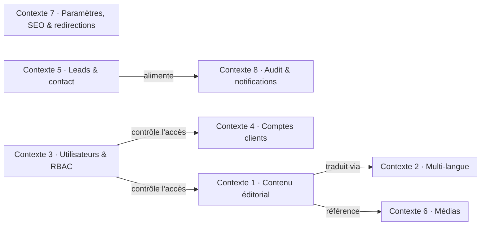

*Figure 1 : carte des 8 contextes délimités et de leurs dépendances principales.*

| # | Contexte | Agrégat racine | Responsabilité |
|---|---|---|---|
| 1 | Contenu éditorial & arborescence | `ContentNode`, `Publication`, `Page` | Structure des services (4 niveaux), pages, publications |
| 2 | Multi-langue | `Language`, traductions par entité | Traductions, fallback, slugs par langue, redirections |
| 3 | Utilisateurs, rôles, permissions | `User` | Accès back-office, RBAC (module × action × langue), sessions |
| 4 | Comptes clients / organisations / documents | `ClientAccount` | Espace client (v2, variantes A/B de Q-005) |
| 5 | Leads & contact | `Lead` | Demandes de contact, traitement, rétention |
| 6 | Médias | `Media` | Uploads, variantes, métadonnées i18n |
| 7 | Paramètres, SEO, redirections | `SiteSetting` | Coordonnées, SEO global, redirections manuelles, langues actives |
| 8 | Audit & notifications | `AuditLog` | Journal immuable, outbox e-mails, consentements |

## 2. Diagrammes de classes par contexte

Convention : attributs `—` (privés applicatifs, gérés par le rendu), méthodes
métier ciblées seulement ; les horodatages `created_at/updated_at` sont
abstraits dans `Timestamped`. Voir la table de correspondance en section 8.

### 2.1 Contexte 1 · Contenu éditorial & arborescence des services

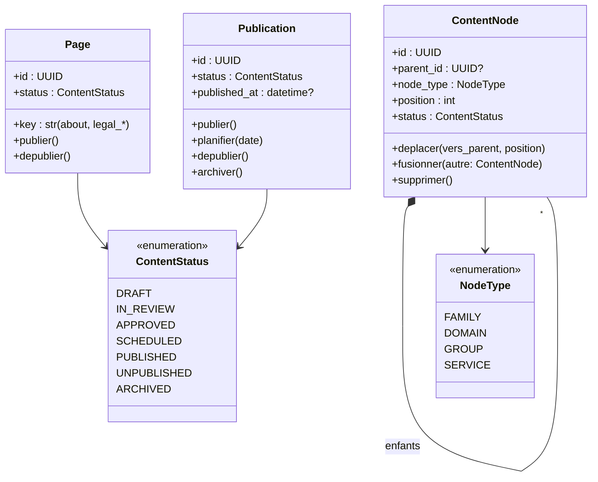

*Figure 2 : agrégat de contenu éditorial. Un `ContentNode` ne change pas de
type en création ; hérité de `Timestamped` (horodatages). Règle : un nœud
`SERVICE` est une feuille ; les niveaux sont extensibles à plus de 4.*

### 2.2 Contexte 2 · Multi-langue / traductions

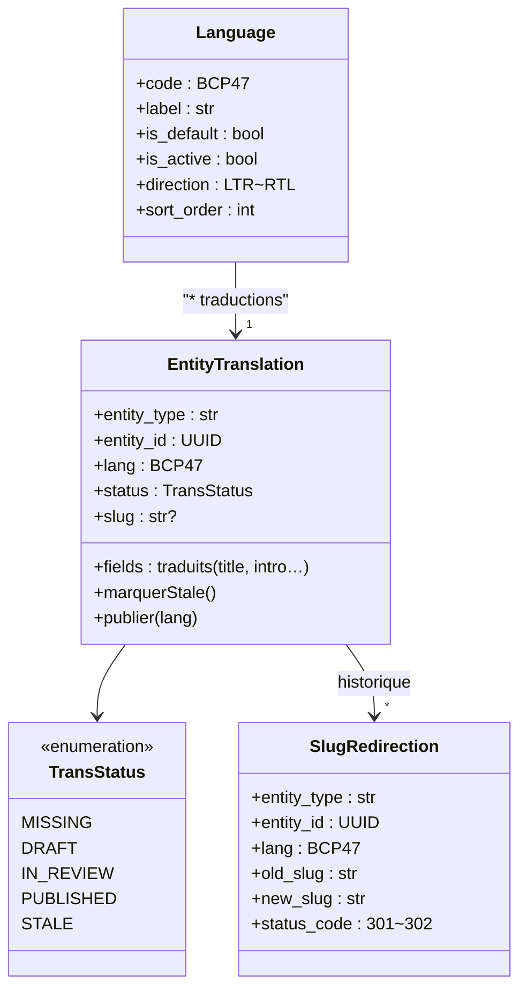

*Figure 3 : la traduction est une ligne par (entité, langue). Le statut
`STALE` est posé automatiquement quand la source change. Stratégie de
stockage : ADR-001 (page 07).*

### 2.3 Contexte 3 · Utilisateurs, rôles, permissions

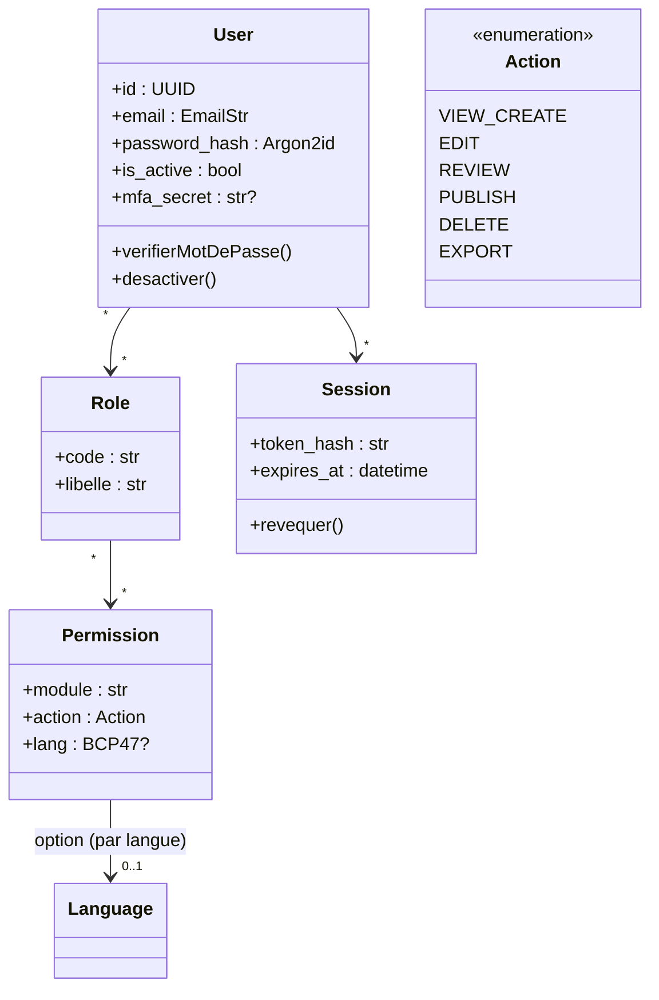

*Figure 4 : RBAC à granularité (module × action × langue). Une permission
sans `lang` vaut toutes langues. Détail des matrices au M4 (page 10).*

### 2.4 Contexte 4 · Comptes clients, organisations, documents

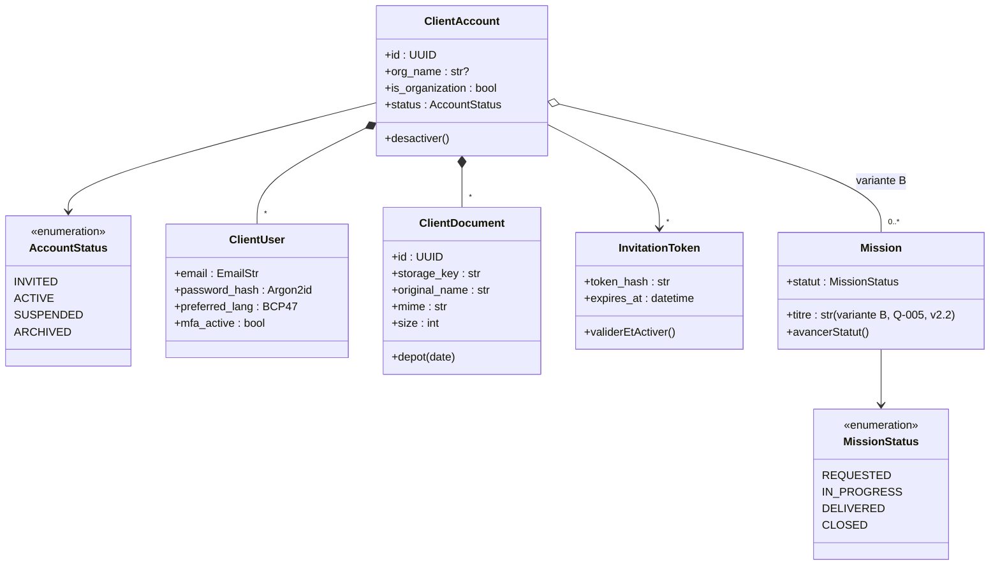

*Figure 5 : l'invitation crée le compte (aucune inscription publique,
EF-401). `Message`/`Conversation` (variante B) sont omis ici pour lisibilité :
même agrégat, ajoutés en v2.2 sans affecter v2.1.*

### 2.5 Contexte 5 · Leads & contact

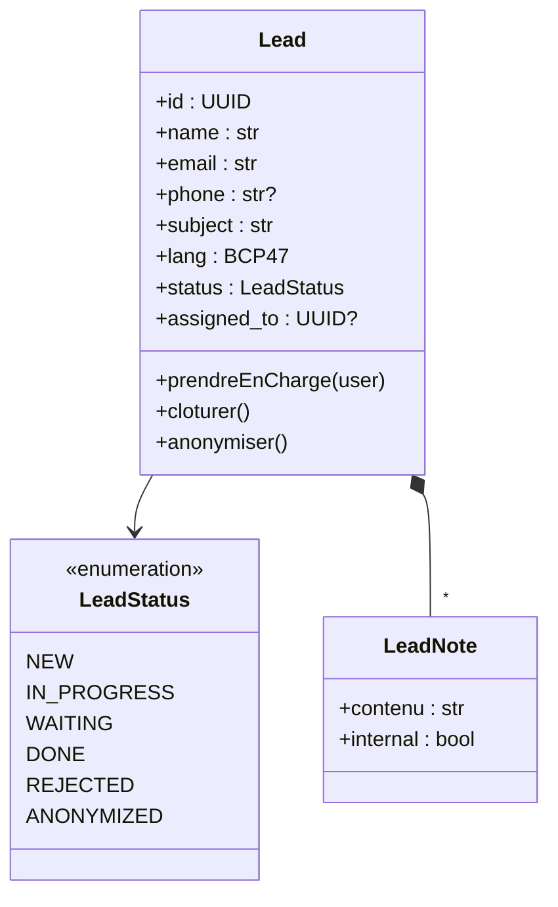

*Figure 6 : le lead est l'agrégat racine du traitement des demandes ;
anonymisation irréversible selon rétention (EF-307, ENF-702).*

### 2.6 Contexte 6 · Médias

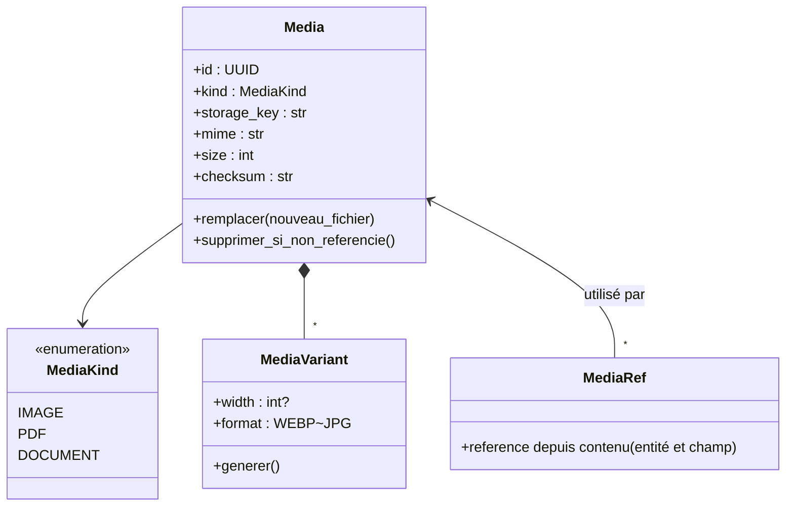

*Figure 7 : la suppression d'un média référencé est refusée (EF-509) ;
le remplacement conserve l'URL publique.*

### 2.7 Contexte 7 · Paramètres, SEO, redirections

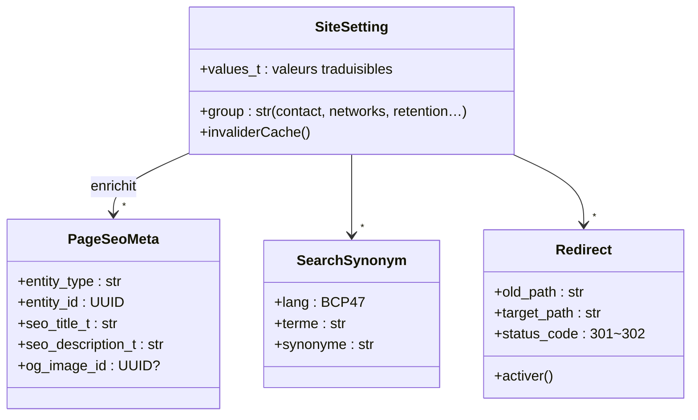

*Figure 8 : les paramètres incluent les coordonnées du cabinet (EF-106) ;
toute modification invalide le cache (SC-550).*

### 2.8 Contexte 8 · Audit & notifications

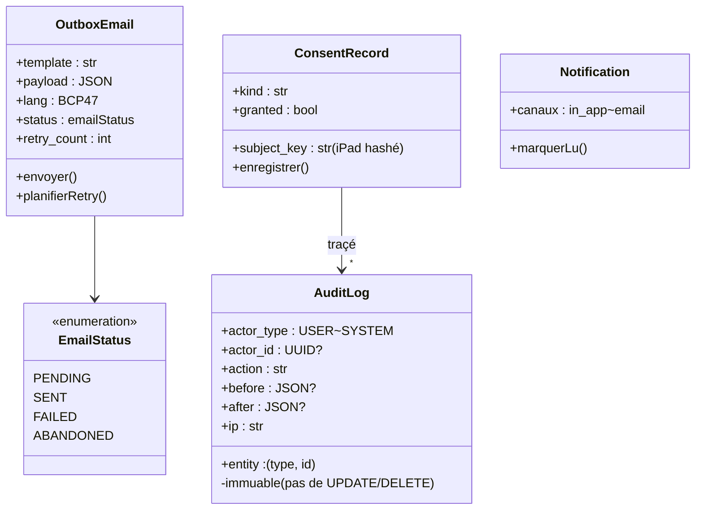

*Figure 9 : l'audit est append-only ; l'Outbox garantit l'envoi (retente avec
back-off — EF-306).*

### 2.9 Vue globale simplifiée

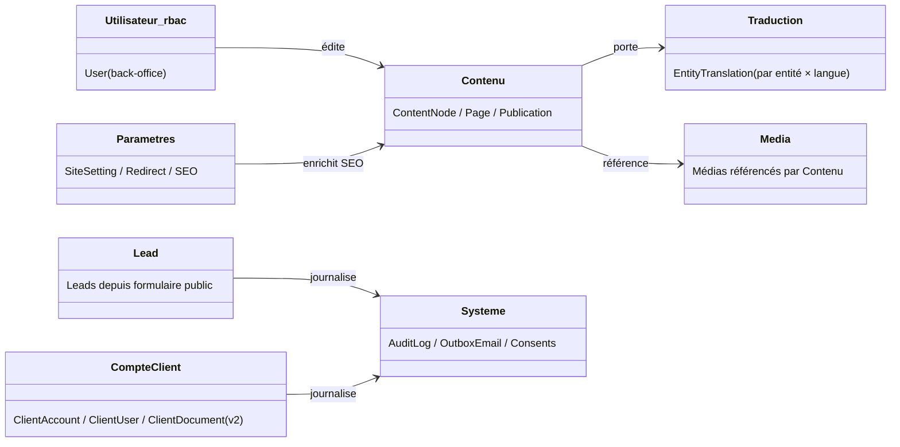

*Figure 10 : vue d'ensemble des 8 agrégats et de leurs liens dominants.*

## 3. Diagrammes de séquence (scénarios clés)

### 3.1 Soumission du formulaire de contact

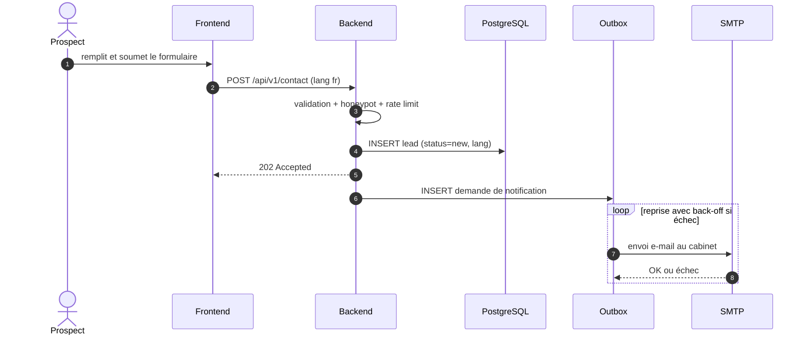

*Figure 11 : l'e-mail ne bloque jamais la réponse 202 ; en cas d'échec SMTP
le lead reste `new` et les tentatives de reprise se poursuivent (EF-306, SC-301).*

### 3.2 Connexion back-office avec MFA

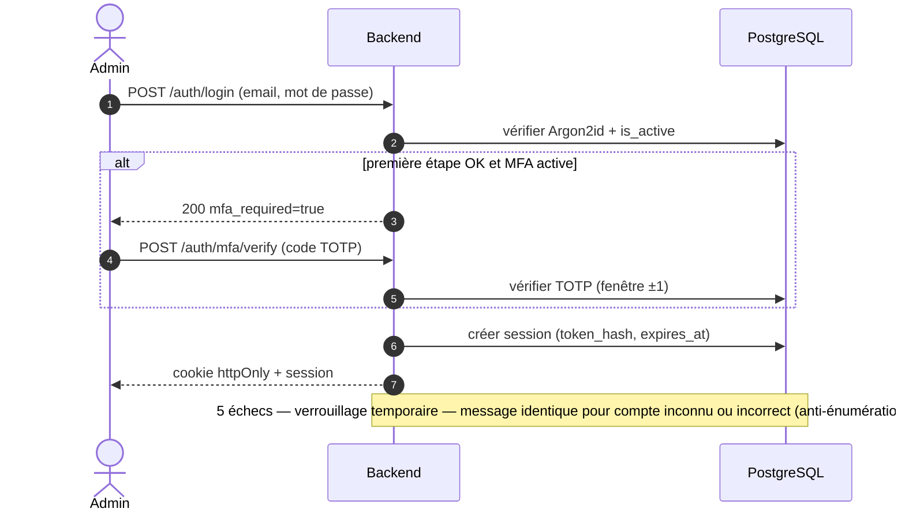

*Figure 12 : session httpOnly, jamais de jeton dans le `localStorage` (page 09).*

### 3.3 Publication d'un contenu + invalidation cache + sitemap

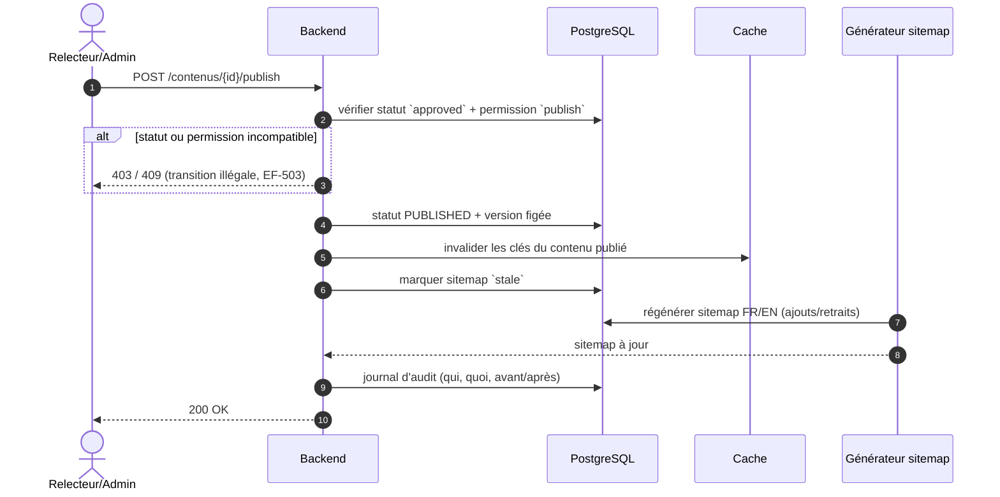

*Figure 13 : publication atomique (statut + version) ; le sitemap se
régénère après l'invalidation, en différé si nécessaire (SC-523).*

### 3.4 Consultation d'un contenu avec repli de langue

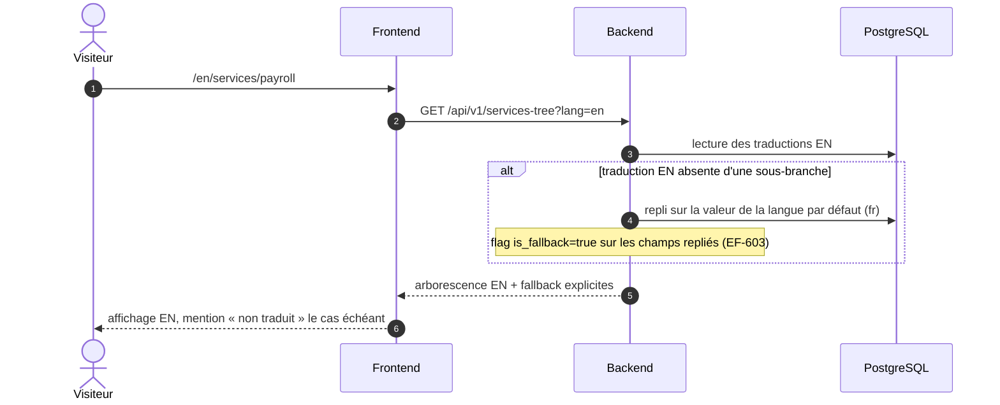

*Figure 14 : le repli est systématiquement signalé au frontend — jamais de
silence (section 07, règle R-FB-1).*

### 3.5 Dépôt / téléchargement d'un document client (contrôle d'accès)

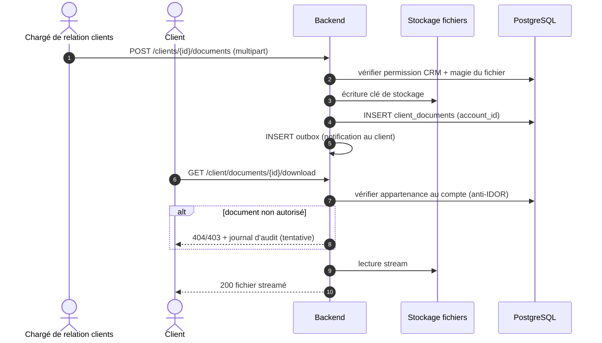

*Figure 15 : tout téléchargement re-vérifie l'appartenance (US-014, SC-404) ;
la notification est asynchrone via l'Outbox.*

### 3.6 Changement de slug avec redirection

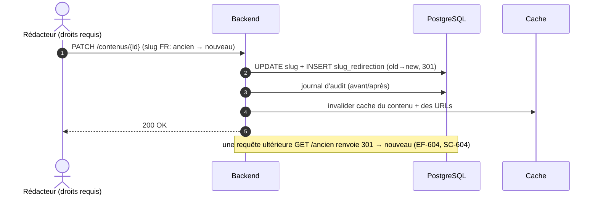

*Figure 16 : redirection de type `301` créée automatiquement, jamais de 404
publique ; en cas de nouvelle modification, la redirection est transitive*

## 4. Diagrammes d'activité

### 4.1 Workflow éditorial

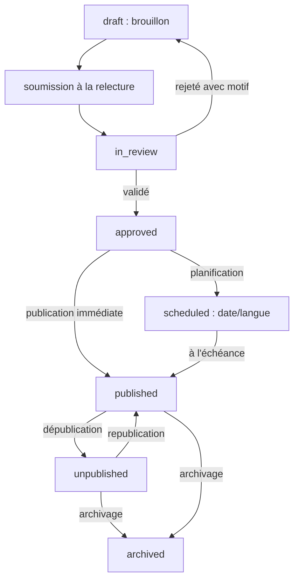

*Figure 17 : les transitions autorisées dépendent du rôle ; toute transition
est journalisée (EF-503, SC-520).*

### 4.2 Traitement d'un lead

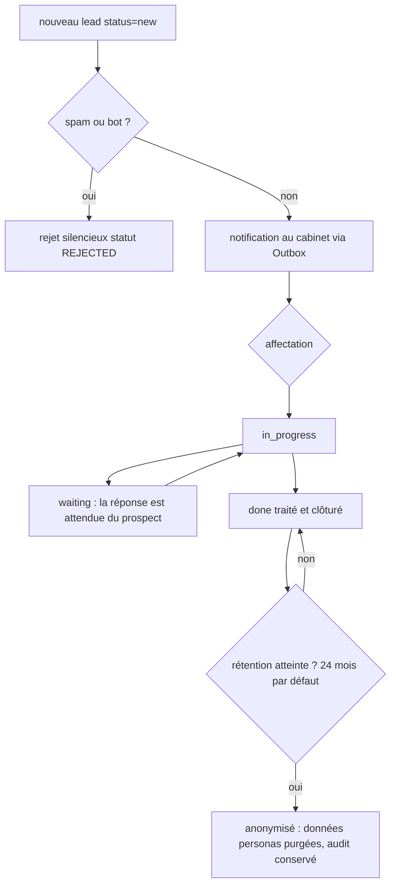

*Figure 18 : anonymisation irréversible (EF-307) ; les notes internes
restent éditables jusqu'à l'anonymisation.*

### 4.3 Cycle de vie d'une traduction

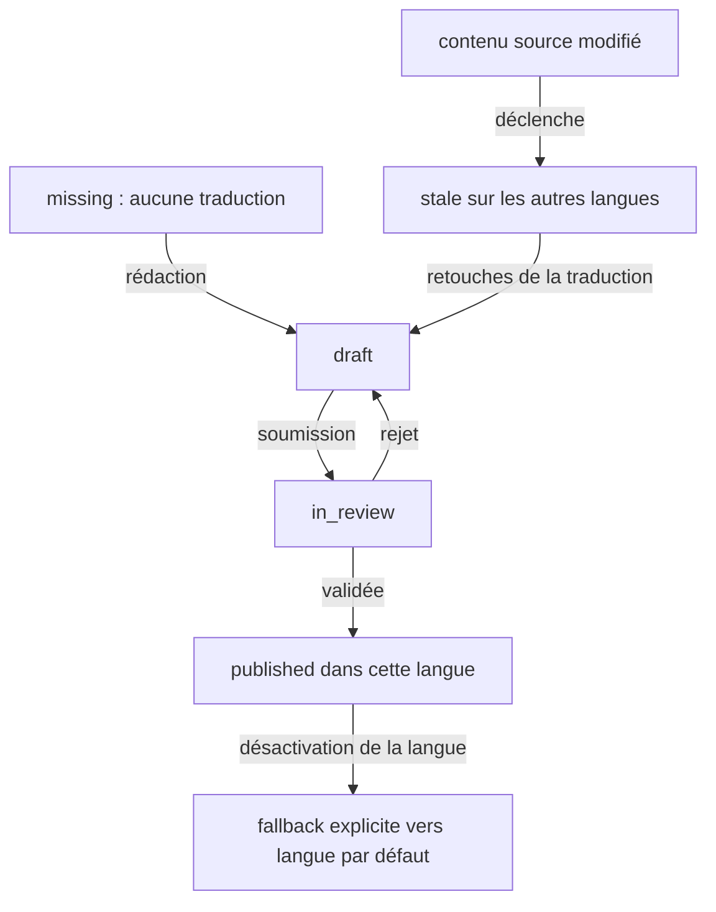

*Figure 19 : le statut est porté par (entité × langue) ; `stale` est
automatique à la modification de la source.*

**

## 5. Règles métier principales (par contexte)

| Contexte | Règles clés (extrait) |
|---|---|
| 1 Contenu | R14-1 : un `SERVICE` est une feuille ; R14-2 : suppression d'un nœud avec enfants = refus (ou cascade questionnaire explicite) ; R14-3 : statut `PUBLISHED` ⇒ immuable sans nouvelle version |
| 2 Multi-langue | R14-4 : la langue par défaut est toujours la source de repli ; R14-5 : slug unique par (type, langue) ; R14-6 : `stale` positionné automatiquement sur changement de source |
| 3 RBAC | R14-7 : permission = module × action × (langue option) ; R14-8 : la session révoquée est effective immédiatement |
| 4 Comptes clients | R14-9 : account n'est créé que par invitation ; R14-10 : tout accès document vérifie l'appartenance du compte |
| 5 Leads | R14-11 : transition de statut uniquement par rôle autorisé et journalisée ; R14-12 : rétention par défaut 24 mois puis anonymisation |
| 6 Médias | R14-13 : suppression refusée si référencé ; remplacement conservant l'URL |
| 7 Paramètres/SEO | R14-14 : chaque changement de paramètre invalide le cache et passe au journal |
| 8 Audit | R14-15 : append-only ; aucune mise à jour ni suppression ; lecture seule sauf rollover |

## 6. Événements du domaine (extraits)

`ContentPublished`, `ContentUnpublished`, `TranslationStale`, `LanguageActivated`,
`LeadCreated`, `LeadAssigned`, `ClientDocumentUploaded`, `ClientInvited`,
`SettingUpdated`, `RedirectCreated`, `SitemapRegenerated`, `EmailQueued`,
`EmailFailed`, `UserSessionRevoked`. Chacun est journalisé en audit et peut
ajouter à l'outbox des notifications (e-mail). Réalisés par le bus interne
(FastAPI events / handlers), pas par un broker externe (H-002).

## 7. Écarts avec `Frontend/docs/api-contract.md`

| Zone | Contrat frontend | Modélisation proposée | Décision |
|---|---|---|---|
| Ressource `services` | un seul endpoint d'arbre `GET /api/services` | `GET /api/v1/services-tree` + détail par domaine, versionné `/v1/` | évolution assumée, documentée en page 08 |
| Réponses | champs `title: {fr, en}` dans le payload | payload mono-langue + `is_fallback`, back-office reçoit toutes langues | évolution, page 13 |
| Coordonnées du cabinet | `ORGANIZATION` défini en dur dans le frontend | servis par l'API depuis `site_settings` (EF-106) | évolution |

Aucune rupture bloquante : contrats réconciliés au moment de la bascule
(page 13).

## 8. Correspondance classes → tables

### Table correspondance classes → tables

| Classe (contexte) | Table principale | Tables liées (voir dictionnaire 06) |
|---|---|---|
| ContentNode (1) | `content_nodes` | `entity_translations`, `content_versions` |
| Page (1) | `pages` | `entity_translations`, `content_versions` |
| Publication (1) | `publications` | `categories`, `entity_translations` |
| Language / EntityTranslation / SlugRedirection (2) | `languages` | `entity_translations`, `slug_redirections` |
| User / Role / Permission / Session (3) | `users` | `roles`, `permissions`, `role_permissions`, `user_roles`, `sessions` |
| ClientAccount / ClientUser / ClientDocument / Mission (4) | `client_accounts` | `client_users`, `client_documents`, `client_invitations`, `missions` (v2.2) |
| Lead / LeadNote (5) | `leads` | `lead_notes` |
| Media / MediaVariant (6) | `medias` | `media_variants`, `media_refs` |
| SiteSetting / PageSeoMeta / Redirect (7) | `site_settings` | `redirects`, `search_synonyms` |
| AuditLog / OutboxEmail / ConsentRecord / Notification (8) | `audit_log` | `outbox_emails`, `notifications`, `consents` |

Chaque classe correspond 1-1 à sa table ; les attributs du diagramme
renvoient aux colonnes du [dictionnaire 06](06-donnees.md).

## 9. Limites connues de la modélisation

- Les énumérations sont écrites en anglais dans le code (états
  `DRAFT/PUBLISHED…`), leurs libellés UI sont traduits (page 07).
- Le contenu « riche » est modélisé à ce stade comme Markdown
  (décision ADR-005, page 14) ; l'alternative « blocs » reste ouverte à
  validation.

> **Précision (corrections M4)** : l'arborescence des services (familles,
> domaines, groupes, prestations) repose sur des **données structurées**
> (champs, ordre, parents) — le Markdown assaini ne concerne que les corps
> rédactionnels (publications, pages). Voir page 06, « Contenu structuré
> vs Markdown » et le test de parité (page 13).
