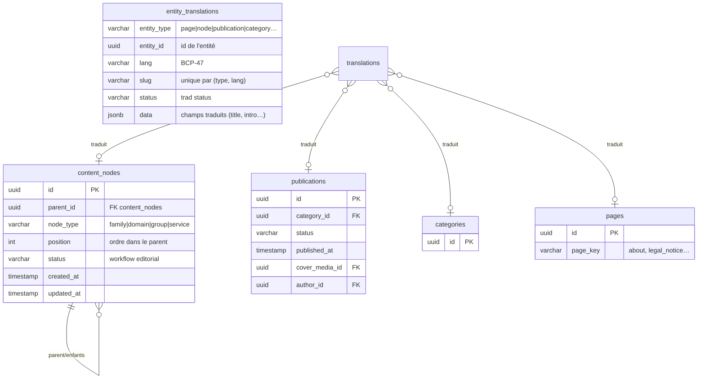
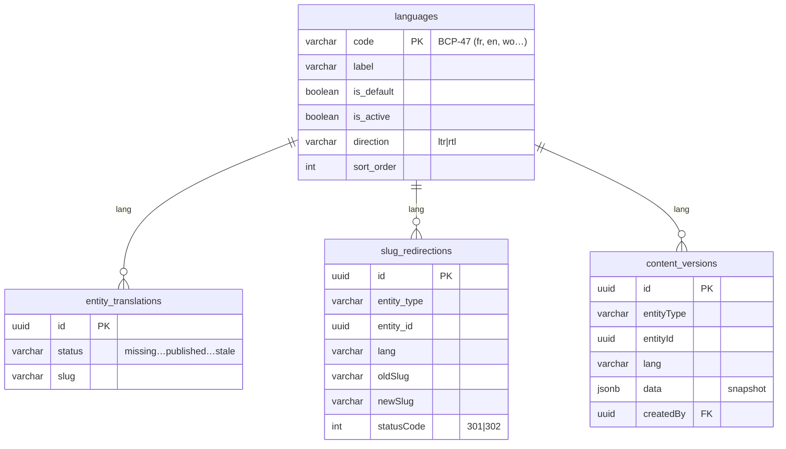
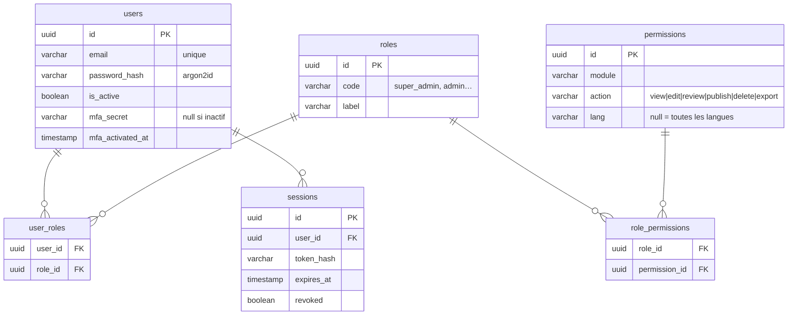
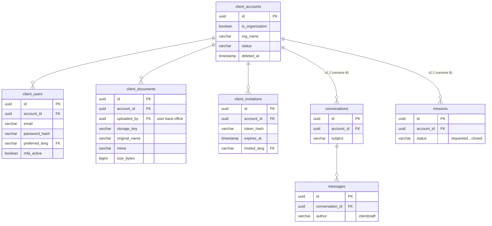
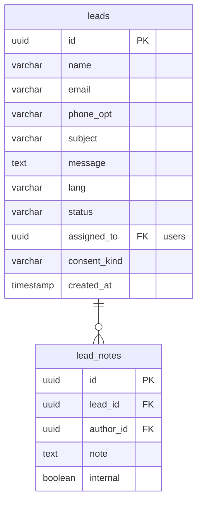
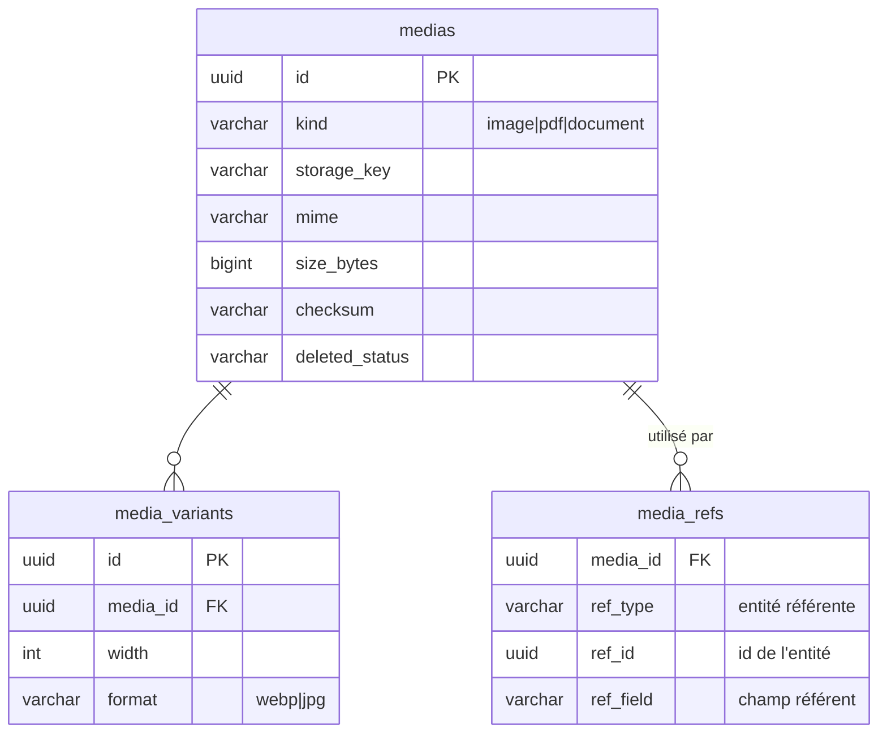
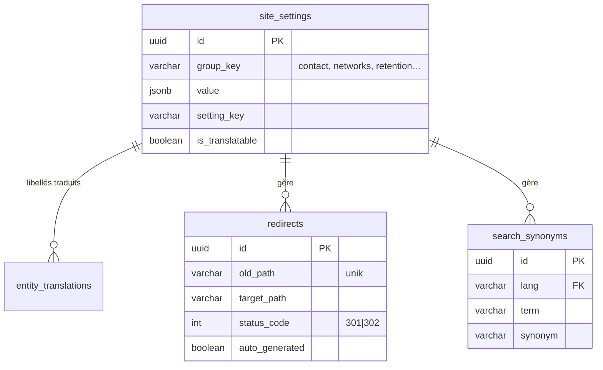
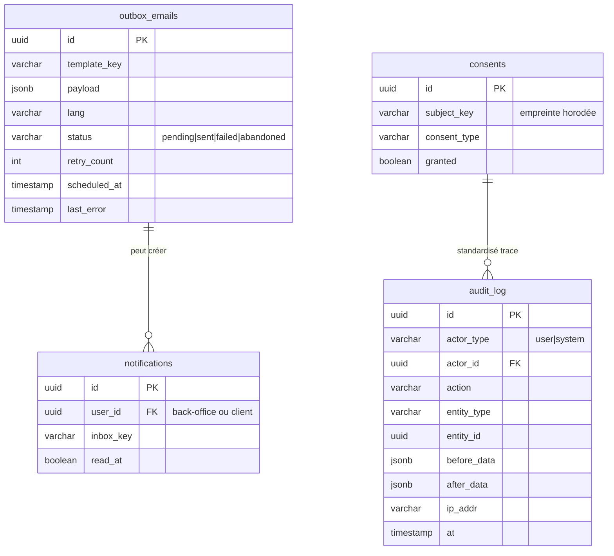
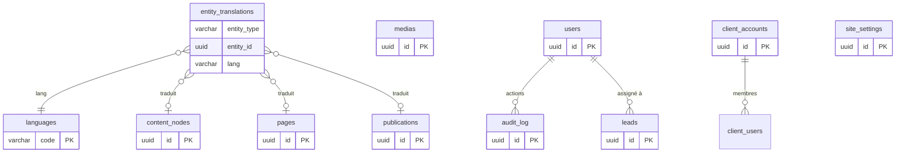

# 06 · Modélisation des données

> 🟡 **Statut : M2 — à faire valider.**
> Diagrammes ER par contexte (≤ 15 éléments), diagramme global simplifié,
> dictionnaire de données exhaustif (un tableau par table), index et
> contraintes, suppression / historisation, migrations Alembic, seed avec
> parité **2 familles · 10 domaines · 20 groupes · 94 prestations**.

La table de correspondance classes ↔ tables est en [05 · Modélisation](05-domaine.md#table-correspondance-classes-tables) et la page [07](07-multi-langue.md) pour les règles
de langue. Les FK, types et contraintes ci-dessous implémentent les
invariants de la stratégie ADR-001 (traductions), ci-dessous.

## 0. Règles transverses

| Règle | Détail |
|---|---|
| PK | `id UUID` (UUIDv4, généré par l'application) |
| Horodatages | `created_at TIMESTAMPTZ`, `updated_at TIMESTAMPTZ`, toujours UTC ; affichage `Africa/Dakar` |
| Suppression logique | Contenus, médias, comptes clients, utilisateurs back-office : `status` / `deleted_at` |
| Historisation | Table `content_versions` (snapshot JSONB par entité × langue) |
| Clés étrangères | Déclarées explicitement, avec `ON DELETE` choisi précisément à chaque table |
| Encodage | UTF8, collation fr (accents insensibles aux correspondances FR/EN via index dédié) |
| Nommage | `snake_case`, FK suffixées `_id`, index `ix_<table>_<col>`, contraintes `ck_…`, `uq_…` |

## 1. Diagrammes ER

### 1.1 Contexte 1 · Contenu éditorial & arborescence



*Figure 1 : ER du contexte contenu. Note : `translations.id` (PK UUID) est
omis dans le diagramme pour lisibilité ; l'unicité est
`(entity_type, entity_id, lang)`.*

### 1.2 Contexte 2 · Multi-langue



*Figure 2 : la table `languages` pilote les langues actives ; une nouvelle
langue = une ligne, aucune migration (EF-602).*

### 1.3 Contexte 3 · Utilisateurs, rôles, permissions



*Figure 3 : la granularité de permission est `module × action × lang`.*

### 1.4 Contexte 4 · Comptes clients (v2)



*Figure 4 : `conversations`, `messages`, `missions` sont de la variante
B (Q-005, v2.2) — schema migré dès v2.1 mais modules désactivés.*

### 1.5 Contexte 5 · Leads & contact



*Figure 5 : le corps du message est assaini au stockage (anti-XSS, cf. page 09).*

### 1.6 Contexte 6 · Médias



*Figure 6 : les métadonnées i18n (alt, légende) vivent dans
`entity_translations` (`entity_type='media'`).*

### 1.7 Contexte 7 · Paramètres, SEO, redirections



*Figure 7 : les coordonnées (EF-106) font partie de `site_settings`
(`group_key='contact'`) — éditables au back-office.*

### 1.8 Contexte 8 · Audit & notifications



*Figure 8 : le `audit_log` est écrit ou rélé depuis tous les contextes.*

### 1.9 Diagramme global simplifié



*Figure 9 : vue d'ensemble ; le cœur est le couple
`entity_translations` + `languages`, autour duquel gravitent contenus,
médias et utilisateurs.*

## 2. Dictionnaire de données (exhaustif)

 Convention : `—` valeurs par défaut ; `NOT NULL` noté `NN` ; `UQ` unique ;
`FK` clé étrangère. Tout index justifié est relisté au §3.

### 2.1 Contexte 2 · langues & traductions

**Table `languages`** — propriétaire fonctionnel : Super-admin.

| Colonne | Type | Contraintes | Description | Exemple |
|---|---|---|---|---|
| code | VARCHAR(10) | PK | Code BCP-47 | `fr` |
| label | VARCHAR(60) | NN | Libellé d'affichage | `Français` |
| is_default | BOOLEAN | NN, 1 seul : `uq_langue_default` | Langue de repli | true (fr) |
| is_active | BOOLEAN | NN | Active publiquement | true |
| direction | VARCHAR(3) | NN, ck ltr/rtl | Sens d'écriture | `ltr` |
| sort_order | SMALLINT | NN | Ordre d'affichage | 1 |

**Table `entity_translations`** — propriétaire : Contenu.

| Colonne | Type | Contraintes | Description | Exemple |
|---|---|---|---|---|
| id | UUID | PK | Identifiant | — |
| entity_type | VARCHAR(32) | NN, CHECK liste fermée | `node` `page` `publication` `category` `media` `setting` `interventiontype` `sector` | `node` |
| entity_id | UUID | NN | ID de l'entité traduite | — |
| lang | VARCHAR(10) | NN, FK languages.code | Langue de la ligne | `en` |
| slug | VARCHAR(180) | UQ par (entity_type, lang) | Slug dans cette langue | `payroll` |
| status | VARCHAR(16) | NN, ck missing/draft/in_review/published/stale | Statut de la traduction | `published` |
| data | JSONB | NN (`{}`) | Champs traduits par type d'entité : `title`, `intro`, `body`, `seo_title`, `seo_description`, `alt`, `caption`… ; schéma validé par type (ADR-001) | `{"title": "Traitement de la Paie"}` |
| published_at | TIMESTAMPTZ |  | Publication de la traduction | — |
| created_at / updated_at | TIMESTAMPTZ | NN | Horodatages | — |
| (uq) | — | `uq_trans (entity_type, entity_id, lang)` | Ligne unique par langue | — |

**Table `content_versions`** — propriétaire : Contenu (historisation).

| Colonne | Type | Contraintes | Description |
|---|---|---|---|
| id | UUID | PK | — |
| entity_type, entity_id | VARCHAR(32), UUID | NN | Entité versionnée |
| lang | VARCHAR(10) | NN, FK | Langue |
| version | INT | NN | N° de version croissant (par entité/langue) |
| data | JSONB | NN | Snapshot complet des champs traduits |
| created_by | UUID | FK users | Auteur de la version |
| created_at | TIMESTAMPTZ | NN | — |

**Table `slug_redirections`** — propriétaire : Contenu/SEO.

| Colonne | Type | Contraintes | Description |
|---|---|---|---|
| id | UUID | PK | — |
| entity_type / entity_id | VARCHAR(32), UUID | NN | Entité concernée |
| lang | VARCHAR(10) | NN, FK | Langue du slug |
| old_slug | VARCHAR(180) | NN | Ancien slug |
| new_slug | VARCHAR(180) | NN | Nouveau slug |
| status_code | SMALLINT | NN, ck 301/302 | Code de redirection |
| uq | — | `uq_redir (entity_type, lang, old_slug)` | Pas de doublon d'ancien slug |

### 2.2 Contexte 1 · contenus

**Table `content_nodes`** — propriétaire : Contenu (arborescence).

| Colonne | Type | Contraintes | Description |
|---|---|---|---|
| id | UUID | PK | — |
| parent_id | UUID | FK content_nodes (NULL = racine famille) | Adjacence : cf. ADR-002 |
| node_type | VARCHAR(8) | NN, ck family/domain/group/service | Type de nœud |
| position | INT | NN | Ordre chez le même parent |
| status | VARCHAR(16) | NN, ck cf. workflow | Workflow éditorial |
| icon_media_id | UUID | FK medias, NULL | Optionnel (pictogramme) |
| created_at / updated_at | TIMESTAMPTZ | NN | — |

**Table `pages`** — propriétaire : Contenu.

| Colonne | Type | Contraintes | Description |
|---|---|---|---|
| id | UUID | PK | — |
| page_key | VARCHAR(40) | NN, UQ | Clef stable : `about`, `legal_notice`, `privacy`, `cookies`, `contact` |
| status | VARCHAR(16) | NN | Workflow éditorial (H-007 pour les légaux) |
| banners_pending | BOOLEAN | NN, def true pour légaux | Banderole « à compléter par le cabinet » |
| created_at / updated_at | TIMESTAMPTZ | NN | — |

**Table `categories` + `publications`** — propriétaire : Contenu.

| Colonne | Type | Contraintes | Description |
|---|---|---|---|
| categories.id | UUID | PK | Catégorie de publication |
| publications.id | UUID | PK | — |
| publications.category_id | UUID | FK categories, NULL | — |
| publications.status | VARCHAR(16) | NN | Workflow éditorial |
| publications.published_at | TIMESTAMPTZ | NULL jusqu'à publication | Ordre = décroissant |
| publications.cover_media_id | UUID | FK medias, NULL | Image de couverture |
| publications.author_id | UUID | FK users, NULL | Auteur du contenu (back-office) |
| publications.legacy_key | VARCHAR(60) | UQ, NULL | Clé du contenu « Exemple » du frontend (migration) |

**Table `intervention_types`** (2 types éditables) :

| Colonne | Type | Contraintes | Description |
|---|---|---|---|
| id | UUID | PK | — |
| code | VARCHAR(20) | UQ | `recurrent`, `oneoff` |
| sort_order | SMALLINT | NN | Ordre d'affichage |

Les 3 secteurs et les 9 sous-catégories vivent dans `sectors` :

| Colonne | Type | Contraintes | Description |
|---|---|---|---|
| id | UUID | PK | — |
| kind | VARCHAR(12) | ck sector/subcategory | Univers ou sous-catégorie |
| parent_id | UUID | FK sectors, NULL si sector | Rattachement |
| approved | BOOLEAN | NN | Descriptif validé par le cabinet (sinon non servi) |

### 2.3 Contexte 3 · utilisateurs back-office

**Table `users`** — propriétaire : Admin / Super-admin.

| Colonne | Type | Contraintes | Description |
|---|---|---|---|
| id | UUID | PK | — |
| email | VARCHAR(255) | NN, UQ | Identifiant de connexion |
| password_hash | VARCHAR(255) | NN | Argon2id (page 09) |
| display_name | VARCHAR(120) | NN | Nom affiché |
| is_active | BOOLEAN | NN | Désactivation immédiate (session révoquée) |
| mfa_secret | VARCHAR(64) | NULL | TOTP si activé |
| last_login_at | TIMESTAMPTZ | NULL | — |
| default_lang | VARCHAR(10) | FK languages | Langue d'interface (défaut `fr`) |
| created_at / updated_at | TIMESTAMPTZ | NN | — |

**Table `roles`** : `id UUID PK`, `code VARCHAR(30) UQ`, `label VARCHAR(60) NN`.
Rôles semés : `super_admin`, `admin`, `editor`, `reviewer`, `crm`, `viewer`.

**Table `permissions`** : `id UUID PK`, `module VARCHAR(20) NN`
(registre : `content`, `tree`, `media`, `leads`, `clients`, `users`, `settings`,
`seo`, `audit`, `backup`), `action VARCHAR(10) NN`
(`view/create/edit/review/publish/delete/export`), `lang VARCHAR(10)` FK
languages NULL = toutes.

**Table `role_permissions`** : pair `(role_id FK, permission_id FK)` PK composite.
**Table `user_roles`** : pair `(user_id, role_id)` PK composite.

**Table `sessions`** : `id UUID PK`, `user_id FK`, `token_hash VARCHAR(64) NN UQ`,
`created_at`, `expires_at NN`, `revoked_at`, `ip INET`, `user_agent`.

### 2.4 Contexte 4 · comptes clients (v2)

**Table `client_accounts`** : `id UUID PK`, `is_organization BOOLEAN NN`,
`org_name VARCHAR(160)`, `status ck invited/active/suspended/archived NN`,
`sector_id FK sectors NULL`,
`preferred_lang FK languages`, `created_at`, `deleted_at`.

**Table `client_users`** : `id UUID PK`, `account_id FK client_accounts NN`,
`email NN`, `password_hash NN (argon2id)`, `display_name NN`,
`preferred_lang FK`, `mfa_active BOOLEAN NN def false`, `is_active NN`,
uq `(account_id, email)`.

**Table `client_documents`** : `id UUID PK`, `account_id FK NN`,
`uploaded_by FK users NULL (nettoyé si admin supprimé)`,
`storage_key VARCHAR(255) NN UQ`, `original_name NN`, `mime NN`,
`size_bytes BIGINT NN`, `created_at`, `deleted_at`.

**Table `client_invitations`** : `id UUID PK`, `account_id FK NN`,
`token_hash NN UQ`, `expires_at NN`, `consumed_at`, `created_by FK users`.

**v2.2 (variante B)** : `conversations` (account_id FK, subject) ; `messages`
(conversation_id FK, author_kind ck client/staff, author_id, body NN, created_at) ;
`missions` (account_id FK, title, status ck requested/in_progress/delivered/closed NN,
requested_by client_user_id FK, assigned_to users FK NULL).

### 2.5 Contexte 5 · leads

**Table `leads`** :

| Colonne | Type | Contraintes | Description |
|---|---|---|---|
| id | UUID | PK | — |
| name | VARCHAR(120) | NN | Nom du prospect |
| email | VARCHAR(255) | NN | E-mail de contact |
| phone | VARCHAR(40) | NULL | Optionnel |
| subject | VARCHAR(200) | NN | Objet |
| message | TEXT | NN | Corps (assaini, page 09) |
| lang | VARCHAR(10) | FK | Langue du lead (i18n : cf. §07, point 10) |
| status | VARCHAR(16) | ck new/in_progress/waiting/done/rejected/anonymized | Workflow de traitement |
| assigned_to | UUID | FK users, NULL | Affectation |
| consent_kind | VARCHAR(20) | NULL | Référence du consentement (CDP) |

**Table `lead_notes`** : `id PK`, `lead_id FK NN`, `author_id FK users NN`,
`note TEXT NN`, `internal BOOLEAN NN`, `created_at`.

### 2.6 Contexte 6 · médias

**Table `medias`** : `id PK`, `kind ck image/pdf/document`, `storage_key NN UQ`,
`mime NN`, `size_bytes BIGINT NN`, `checksum VARCHAR(64) NN`,
`status ck active/replaced/deleted`, `replaced_by FK medias`,
`uploaded_by FK users`, created/updated. Métadonnées i18n (alt/légende)
dans `entity_translations` (`entity_type='media'`).

**Table `media_variants`** : `id PK`, `media_id FK NN`, `width SMALLINT`,
`format ck webp/jpg`, `storage_key NN UQ`.

**Table `media_refs`** : `id PK`, `media_id FK NN`,
`ref_type VARCHAR(32) NN`, `ref_id UUID NN`, `ref_field VARCHAR(40) NN`
(justifie l'index au §3, impose la suppression conditionnelle).

### 2.7 Contexte 7 · paramètres, SEO, redirections

**Table `site_settings`** : `id PK`, `group_key VARCHAR(40) NN`
(`contact`, `networks`, `general`, `retention`, `seo`), `setting_key VARCHAR(40) NN`,
uq `(group_key, setting_key)`,
`value JSONB NN` (scalaire ou objet),
`is_translatable BOOLEAN NN` (si oui : libellés traduits dans `entity_translations`,
`entity_type='setting'`), `updated_by FK users`, `updated_at`.

**Table `redirects`** : `id PK`, `old_path VARCHAR(500) NN UQ`,
`target_path NN`, `status_code ck 301/302`, `auto_generated BOOLEAN NN`,
`created_at`.

**Table `search_synonyms`** : `id PK`, `lang FK NN`, `term NN`, `synonym NN`,
uq `(lang, term, synonym)` — EF-204.

### 2.8 Contexte 8 · audit & notifications

**Table `audit_log`** : `id PK`, `at TIMESTAMPTZ NN`,
`actor_type ck user/system`, `actor_id FK users NULL`,
`action VARCHAR(40) NN`, `entity_type VARCHAR(32) NN`, `entity_id UUID`,
`before_data JSONB`, `after_data JSONB`, `ip INET`, `user_agent`.
**Append-only** : aucun UPDATE/DELETE en app ; le rollover d'archive est
opéré par un job système (ENF-701).

**Table `outbox_emails`** : `id PK`, `template_key NN`, `payload JSONB NN`,
`lang FK`, `status ck pending/sent/failed/abandoned NN`, `retry_count INT NN def 0`,
`scheduled_at`, `sent_at`, `last_error`.

**Table `notifications`** : `id PK`, `user_id FK NN`, `kind NN`,
`payload JSONB`, `read_at NULL`. 

**Table `consents`** : `id PK`, `subject_hash VARCHAR(64)` (IP côté client,
non réversible ou pseudonymisé de façon paramétrée — À VALIDER avec CDP),
`consent_type ck cookies/forms`, `granted BOOLEAN NN`, `timestamp NN`,
`source VARCHAR(20)`.

## 3. Index et contraintes d'intégrité

| Table | Index / contrainte | Justification |
|---|---|---|
| entity_translations | (entity_type, entity_id) ; (lang, status) | menus d'arbre, filtre « à traduire »
| entity_translations | UQ (entity_type, entity_id, lang) | invariant i18n |
| entity_translations | UQ (entity_type, lang, slug) | slug unique par langue (EF-604) |
| content_nodes | (parent_id, position) | ordre stable d'affichage |
| content_nodes | (node_type, status) | filtres back-office |
| publications | (status, published_at) | listes triées + filtres |
| slug_redirections | UQ (entity_type, lang, oldSlug) | pas de règle contradictoire |
| leads | (status, created_at) | files de traitement |
| sessions | (user_id), (expires_at) | révocation et purge |
| client_documents | UQ (account_id, original_name) RIEN | l'unicité n'est PAS imposée (SC-404) |
| media_refs | (ref_type, ref_id) | liste des référents à jour |
| audit_log | (entity), (at) | consultabilité (EF-901) |
| site_settings | UQ (group_key, setting_key) | invariant des paramètres |
| full-text | table miroir `search_index` — GIN(tsv), (lang), config par langue | recherche EF-201 — synchronisation : ADR-001 bis (page 07) |

Contraintes croisées : toutes FK `RESTRICT` sauf historisation des
utilisateurs supprimés (`ON DELETE SET NULL` sur `leads.assigned_to`,
`content_versions.created_by`) ; touts statuts via CHECK ; les slugs
publiés et `old_slug` sont format NFC (validation applicative).

## ADR-002 · Modèle de l'arborescence des services

```admonition success title="ADR-002 · Liste d'adjacence + contrôles applicatifs"
**Contexte** : l'arborescence des services fait 4 niveaux aujourd'hui
(familles → domaines → groupes → prestations) et doit rester extensible en
profondeur ; on déplace, fusionne, supprime des nœuds (EF-508) ; les slugs
de URL doivent rester stables.

**Options** :
- *L1 · liste d'adjacence* (parent_id sur chaque nœud) — simple, une
  requête récursive (CTE) par lecture de sous-arbre ;
- *L2 · chemin matérialisé / `ltree`* — lecture de sous-arbre par
  préfixe (`npath <@ 'a.b.c'`) mais déplacements = réécriture du chemin
  de tout le sous-arbre, extension non-stockable type ltree à chaque
  profondeur ;
- *L3 · table de fermeture* (`node_ancestors(node_id, ancestor_id,
  depth)`) — lectures et sous-arbres faciles et indexables, mais 3
  écritures pour un déplacement à N niveaux et une table
  supplémentaire.

**Décision** : **L1 — liste d'adjacence**, avec les garde-fous suivants :
1. **Absence de cycles** : garantie applicative (un nœud ne se déplace
   que vers un parent qui n'est pas son descendant — vérifié par une CTE
   récursive de la lignée du parent cible, requête type ci-dessous) ;
   le `node_type` requis du parent cible donne par ailleurs une garde de
   cohérence (un `service` n'accepte pas d'enfants, R14-1).
2. **Lecture de sous-arbres** : CTE récursive `WITH RECURSIVE …` indexée
   sur `(parent_id, position)` — largement suffisante à l'échelle du
   site (des centaines de nœuds, pas des millions).
3. **Cohérence du chemin lors d'un déplacement** : les slugs sont
   *plats* (uniques par (type, langue), sans chemin préfixé) ; un
   déplacement ne change donc pas les slugs mais peut changer l'URL
   publique — auquel cas une redirection est créée (comme un
   changement de slug, EF-604). C'est l'avantage central : **le chemin
   URL dépend du contexte de route, pas du stockage**.
4. **Unicité de slug par parent et par langue** : le slug
   (`entity_translations`) est détenu par le nœud, unique par
   (entity_type, lang, slug) au niveau global — plus contraignant que
   « par parent », donc sans conflit de renommage chez les cousins ; la
   position `(parent_id, position)` est elle UQ (UQ composite), et
   l'unicité « par parent et par langue » est assurée de manière
   transitive par l'app lors de la rédaction.
5. **Profondeur** : contrôlée par app (constante `MAX_TREE_DEPTH = 6`,
   ajustable) — pas en DDL (SQLCHECK ne sait pas lire un arbre).

**Ce qu'on perd / accepte** : la vérification anti-cycle n'est pas en DDL
(pur applicatif + job hebdomadaire de contrôle : un nœud apparaît 2× dans
un chemin ⇒ alerte) ; deux tables de plus à maintenir plus tard si le
volume le justifie (une migration L1→L3 est simple).
```

**Requête type — lignée d'un parent (détecter cycles avant déplacement) :**

```sql
WITH RECURSIVE lineage AS (
  SELECT id, parent_id FROM content_nodes WHERE id = :target_parent
  UNION ALL
  SELECT n.id, n.parent_id FROM content_nodes n
  JOIN lineage l ON l.parent_id = n.id
)
SELECT true AS cycle_possible
FROM lineage WHERE id = :node_to_move;
-- (l'app refuse le déplacement si le nœud et son ancêtre se rejoignent)
```


## Contenu structuré vs Markdown (précision de périmètre)

**Les familles, domaines, groupes et prestations sont des DONNÉES
STRUCTURÉES**, pas du texte libre : lignes de `content_nodes` (type,
parent, position) + champs traduits structurés dans `entity_translations
.data` (`title`, `intro`, ordre, références aux secteurs). Cette
structure est ce qui rend possible le test de parité automatique
2 familles / 10 domaines / 20 groupes / 94 prestations (page 13) et la
navigation API `services-tree`.

**Le Markdown assaini (ADR-005) ne s'applique qu'aux champs
rédactionnels** : corps des publications, textes riches des pages
éditoriales (« À propos », pages légales), etc. Jamais à la structure de
l'arborescence des services ni aux valeurs servant la REH.

## 4. Stratégies de suppression & d'historisation

| Entité | Suppression | Historisation | Rétention |
|---|---|---|---|
| Contenu (nœud/page/publication) | logique (`status=archived`) ; possible après refus d'enfants (règles R14-1…R14-3) | `content_versions` par langue (défaut illimité) | archive ≤ 3 ans |
| Traduction | opérée via l'entité | idem versions | — |
| Média | refus de la suppression si référencé ; sinon `status=deleted` + fichier en quarantaine 30 j | variants conservés | — |
| Lead | anonymisation (irréversible) selon rétention, audit conservé | — | 24 mois (défaut, ENF-702) |
| Comptes client | désactivation puis anonymisation (demande EF-405) | documents en quarantaine avant purge | — |
| Utilisateur back-office | `is_active=false` ; FK annotées SET NULL | les sessions révoquées | — |
| Audit | jamais — rollover système de l'archive uniquement | — | 3 ans (À VALIDER JURIDIQUEMENT) |

## 5. Migrations (Alembic)

- Migrations versionnées `alembic revision --autogenerate`, la première crée
  le schéma v1 ; les suivantes sont additives (jamais destructives sans
  revue).
- Convention de noms : `NNNN_description_courte.py`.
- Chaque migration : `upgrade()` + `downgrade()` testés en CI sur une base
  éphémère (cf. page 12).
- La table `languages` est semée (fr activé par défaut, en activé) dès la
  migration initiale — l'ajout de langues ultérieures est une opération
  de données, pas de schéma (EF-602).
- Système d'extension PG requis : `pg_trgm` (recherche floue, option) ;
  pas de `ltree` (ADR-002 liste d'adjacence + CHECK de profondeur app, à
  valider au M2 — c'est la recommandation, rester simple, v1 sans service
  in-house).

## 6. Seed et parité (US-011, page 13)

Le seed créé à partir de `Frontend/src/data/content.data.ts` :

1. 1. Langues : `fr` (défaut, active), `en` (active).
2. Contenu du rendu du frontend : `content_nodes` (2 familles → 10 domaines
   → 20 groupes → 94 prestations), avec positions conservées 1..N par parent.
3. `entity_translations` : une ligne par (nœud, `fr`) et une par (nœud, `en`),
   slugs exactement identiques à ceux composant les `PAGE_SLUGS` du
   frontend (`fr/services/accompagnement/…` ↔ `en/services/support/…`).
4. `pages` : `about`, `contact`, `legal_*` (statut `draft` + `banners_pending`,
   H-007).
5. `publications` : les 3 « Exemple » (statut `draft`, `legacy_key` pour la
   correspondance avec le frontend).
6. `sectors` : 3 secteurs + 9 sous-catégories (`approved=false` tant que les
   descriptifs de `propositions-secteurs.md` ne sont pas validés).
7. `site_settings` : `contact` (e-mail, tél fixe +221 33 814 51 24, tél mobile
   +221 77 099 31 83, ville Dakar), `seo` (og image par défaut = logo).

**Test de parité (doit s'exécuter en CI)** :

| Vérification | Valeur attendue |
|---|---|
| `COUNT(content_nodes WHERE node_type='family')` | 2 |
| `COUNT(... 'domain')` | 10 |
| `COUNT(... 'group')` | 20 |
| `COUNT(... 'service')` | 94 |
| slugs FR/EN vs `PAGE_SLUGS` | 100 % identiques |
| secteurs / sous-catégories | 3 / 9 |
| publications « Exemple » importées | 3 (draft) |

## 7. DDL illustratif (extrait, non exécuté — aucun code applicatif)

```sql
CREATE TABLE languages (
  code          VARCHAR(10) PRIMARY KEY,
  label         VARCHAR(60)  NOT NULL,
  is_default    BOOLEAN      NOT NULL DEFAULT false,
  is_active     BOOLEAN      NOT NULL DEFAULT false,
  direction     VARCHAR(3)   NOT NULL CHECK (direction IN ('ltr','rtl')),
  sort_order    SMALLINT     NOT NULL,
  uq_is_default UNIQUE (is_default) WHERE (is_default),
  ck_one_lang   CHECK (1 = (SELECT COUNT(*) FROM languages WHERE is_default))
);
-- (indication : l'unicité du défaut est plutôt garantie par un index
-- partiel sur is_default=true et par une validation applicative)

CREATE TABLE entity_translations (
  id           UUID PRIMARY KEY,
  entity_type  VARCHAR(32) NOT NULL,
  entity_id    UUID        NOT NULL,
  lang         VARCHAR(10) NOT NULL REFERENCES languages(code),
  slug         VARCHAR(180),
  status       VARCHAR(16) NOT NULL DEFAULT 'missing' CHECK (status IN
                 ('missing','draft','in_review','published','stale')),
  data         JSONB       NOT NULL DEFAULT '{}',
  created_at   TIMESTAMPTZ NOT NULL DEFAULT now(),
  updated_at   TIMESTAMPTZ NOT NULL DEFAULT now(),
  uq_trans UNIQUE (entity_type, entity_id, lang),
  uq_slug  UNIQUE (entity_type, lang, slug)
);
CREATE INDEX ix_trans_entity ON entity_translations (entity_type, entity_id);
-- (full-text : voir la table miroir search_index, page 07 §2.2).
```

**(le DDL ci-dessus illustre les invariants ; l'index full-text avec config par langue est détaillé en page 07, et la rédaction finale a lieu au backend, M6+).*
