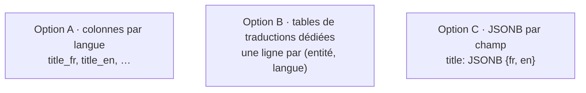
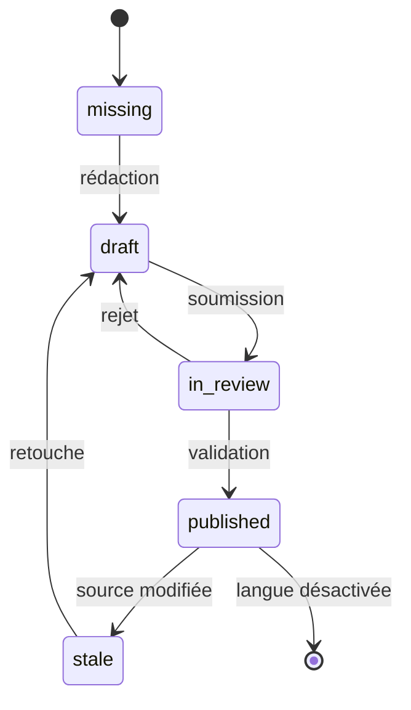

# 07 · Multi-langue (i18n / l10n)

> 🟡 **Statut : M2 — à faire valider.**
> Section de référence i18n ; les autres pages (02 EF-F, 05 fig. 3, 06 §1.2,
> 08 API, 09 e-mails, 10 back-office, 13 migration) en appliquent les
> décisions. FR = langue par défaut ; EN active ; **N langues sans refonte
> de schéma**.

## 1. Périmètre i18n : ce qui est traduisible

| Entité | Traduisible | Champs concernés | Détail |
|---|---|---|---|
| Pages (home, about, contact, légaux…) | ✅ | title, intro, body, slug, SEO, libellé de navigation | H-007 : légaux « à compléter » par bandeau par langue |
| Blocs de page (`page_sections`) | ✅ | textes de la section : kicker, titre, corps, libellés de CTA, items (`items[].title/text`) | `entity_type='page_section'` ; `config` reste non traduit (doc 16 §3) |
| Bureaux (`offices`) | ✅ | name, address_lines, city, region, hours, notes, photo_alt | `entity_type='office'` ; téléphones/e-mail/carte non traduits |
| Équipe et fondateur (`team_members`) | ✅ | full_name, role, bio, photo_alt | `entity_type='team_member'` |
| Nœuds de l'arborescence services | ✅ | title, intro, body, slug | 4 niveaux, statut de traduction par nœud |
| Prestations / groupes / domaines / familles | ✅ | idem | mêmes règles que les nœuds ; slug obligatoire (doc 16 §7) |
| Intervention types | ✅ | title, intro, signature | 2 types, éditables |
| Secteurs & sous-catégories | ✅ | title, description | non servis si `approved=false` (EF-104) |
| Publications | ✅ | title, intro, body, slug, SEO | publication possiblement par langue |
| Catégories | ✅ | title, slug | — |
| Paramètres du site | ✅ si marqué translatable | `identity.tagline`, `ui_copy.*` (CTA partagés), `cookies.*`, `legal.banner_text` | `entity_type='setting'` ; les valeurs traduisibles ne sont pas dupliquées dans `site_settings.value` |
| Métadonnées SEO | ✅ | seo_title, seo_description, `og_media_id` | par langue ; repli sur l'OG global |
| E-mails transactionnels | ✅ | template key + langue du destinataire (lead, client) | cf. point 10 |
| Messages d'erreur API | ✅ | clés code → libellé dictionnaire app | cf. page 08 |
| Libellés UI (frontend + back-office) | ✅ | fichiers de traduction frontend, i18n back-office (FR d'abord) | **exception assumée** : les libellés de contrôles ne sont pas éditables en base (doc 15 §17) |
| Médias (alt, légendes) | ✅ | via `entity_translations` (`entity_type='media'`) | — |
| Documents clients | partiel | titre descriptif ; le contenu du fichier n'est pas traduit (H-008) | v2 |

## 2. Stratégies de stockage — comparaison et ADR

### 2.1 Les trois options



*Figure 1 : les trois stratégies candidates (ADR-001).*

| Critère | A · Colonnes par langue | B · Tables de traductions dédiées | C · JSONB |
|---|---|---|---|
| Intégrité (NOT NULL langue par défaut) | ✅ forte | 🟡 forte via validation (exigée app) | ❌ faible |
| Ajout d'une langue | ❌ migration ALTER TABLE | ✅ aucune migration | ✅ aucune migration |
| Requêtes « toutes langues » (back-office) | 🟡 n colonnes | ✅ 1 requête par langue | ✅ 1 colonne |
| Recherche full-text par langue | 🟡 index par colonne | ✅ réaliste, index GIN par langue (lang noted) | ❌ coûteux |
| Slugs par langue + unicité | 🟡 colonnes dédiées | ✅ `(entity_type, lang, slug)` | ❌ |
| Simplicité back-office (édition côte à côte) | 🟡 | ✅ simple | 🟡 |
| Volume (21 entités × N langues) | — | ✅ raisonnable | ✅ raisonnable |
| Migrations (champ traduit ajouté) | ❌ | 🟡 ALTER table de traduction uniquement | ✅ |

### ADR-001 · Stratégie de stockage des traductions

```admonition success title="ADR-001 · Tables de traductions dédiées (génériques)"
**Contexte** : FR+EN aujourd'hui, N langues visibles (dont éventuellement RTL).

**Options** : (A) colonnes par langue — intégrité maximale mais
migration à chaque langue ; (B) une table générique
`entity_translations(entity_type, entity_id, lang, …)` ; (C) JSONB par
champ sur les entités elles-mêmes — flexible mais intégrité et recherche
faibles, et les entités deviennent génériques elles aussi (perd les FK).

**Décision** : **option B sous la forme exacte suivante** —

- **Une ligne par (entity_type, entity_id, lang)** — pas une ligne par
  champ (les champs d'une langue se lisent/écrivent ensemble, l'unité de
  workflow de traduction est le couple entité×langue).
- Les champs traduits de texte vivent dans une **colonne `data JSONB`**
  (`title`, `intro`, `body`, `seo_title`, `seo_description`, `alt`,
  `caption`… selon le type d'entité).
- Les **invariants sortent du JSONB** et sont de vraies colonnes :
  `slug` (VARCHAR, unicité `(entity_type, lang, slug)`), `status`
  (CHECK), `published_at`, horodatages. Cela garde slug/statut
  contraignables en SQL.
- La table reste **générique** (`entity_type` discriminant) pour éviter
  ~10 tables jumelles ; une clé `(entity_type, entity_id)` sans FK réelle
  — garde-fous ci-dessous.

**Décision affinée — pourquoi JSONB et pas des colonnes dédiées** : les
types d'entités traduites n'ont pas les mêmes champs (une publication a
un `body`, un média a `alt`/`caption`, un nœud n'a pas de `body` des
groupes feuilles tailles variables…). Une colonne `data JSONB` par ligne
garde une seule table, un seul index full-text généré, et schema
évoluable sans migration (ajout d'un champ traduisible = convention d'une
clé JSONB documentée au dictionnaire).

**Garde-fous d'intégrité (polymorphisme sans FK)** :

1. **Registre contraignant** : CHECK sur `entity_type` ∈ liste fermée
   (`node, page, page_section, publication, category, media, setting,
   interventiontype, sector, office, team_member`) — impossible d'écrire un
   type inconnu (DDL ci-dessous).
2. **Écriture transactionnelle** : la création/l'écriture d'une entité
   et de ses traductions passe par la même couche applicative, dans la
   même transaction SQL — jamais d'INSERT orphelin possible côté app.
3. **Nettoyage à la suppression d'une entité** : suppression d'un nœud,
   d'une publication… ⇒ suppression CASCADE applicative (explicite) de ses `entity_translations`, `content_versions` et `redirects` dans la même transaction ; aucune FK SQL directe n'existe pour `entity_id` polymorphe — c'est le point 4 qui garantit la détection.
4. **Détection des orphelins** : job quotidien (planificateur) :
   `SELECT ... FROM entity_translations t WHERE NOT EXISTS (SELECT 1 FROM <table_ref>{"<
     identifiée par entity_type>) r WHERE r.id = t.entity_id` — alerte
   bloque le déploiement si non vide (ENF-601) ; en cas d'orphan détecté :
   purge \u0026 alerte admin au super-admin.
5. **Types contrôlés** : schémas Pydantic par `entity_type` valident la
   structure du JSONB (le champ `title` est présent et non vide pour la
   langue par défaut, longueurs contrôlées, pas de tags HTML non autorisés).

**DDL exact** :

```sql
CREATE TABLE languages (
  code          VARCHAR(10) PRIMARY KEY,
  label         VARCHAR(60)  NOT NULL,
  is_default    BOOLEAN      NOT NULL DEFAULT false,
  is_active     BOOLEAN      NOT NULL DEFAULT false,
  direction     VARCHAR(3)   NOT NULL DEFAULT 'ltr'
                CHECK (direction IN ('ltr','rtl')),
  sort_order    SMALLINT     NOT NULL
);

CREATE TABLE entity_translations (
  id           UUID PRIMARY KEY,
  entity_type  VARCHAR(32) NOT NULL CHECK (entity_type IN
                 ('node','page','page_section','publication','category',
                  'media','setting','interventiontype','sector','office',
                  'team_member')),
  entity_id    UUID        NOT NULL,
  lang         VARCHAR(10) NOT NULL REFERENCES languages(code),
  slug         VARCHAR(180),
  og_media_id  UUID        REFERENCES medias(id) ON DELETE SET NULL,
  status       VARCHAR(16) NOT NULL DEFAULT 'missing'
               CHECK (status IN ('missing','draft','in_review','published','stale')),
  data         JSONB       NOT NULL DEFAULT '{}',
  published_at TIMESTAMPTZ,
  created_at   TIMESTAMPTZ NOT NULL DEFAULT now(),
  updated_at   TIMESTAMPTZ NOT NULL DEFAULT now()
);
-- une seule ligne par entité et langue
ALTER TABLE entity_translations
  ADD CONSTRAINT uq_trans UNIQUE (entity_type, entity_id, lang);
-- slug unique par type d'entité et langue (NULL = entité sans URL)
CREATE UNIQUE INDEX uq_trans_slug
  ON entity_translations (entity_type, lang, slug)
  WHERE slug IS NOT NULL;
-- titre non vide obligatoire pour la langue par défaut — pas exprimable
-- en une contrainte stockée simplement ; vérifié par l'application
-- avant toute écriture (le contrat Pydantic l'impose, cf. point 5).
```

**Requête type 1 — lecture publique d'un nœud avec repli de langue
(une seule requête)** :

```sql
-- lang demandé : :lang (ex. 'en') ; repli : langue par défaut (:def, ex. 'fr')
SELECT n.id, n.node_type, n.parent_id, n.position, n.status,
       COALESCE(en.data ->> 'title',   def.data ->> 'title')   AS title,
       COALESCE(en.data ->> 'intro',   def.data ->> 'intro')   AS intro,
       COALESCE(en.slug,  def.slug)                            AS slug,
       (en.id IS NULL)                                         AS is_fallback,
       COALESCE(en.status, 'missing')                          AS lang_status
FROM content_nodes n
LEFT JOIN entity_translations en  ON en.entity_id = n.id
       AND en.entity_type = 'node' AND en.lang = :lang
  AND en.status = 'published'          -- jamais de draft exposé (L7/S9)
LEFT JOIN entity_translations def ON def.entity_id = n.id
       AND def.entity_type = 'node' AND def.lang = :def
  AND def.status = 'published'
WHERE n.status = 'published'
  AND n.node_type <> 'service'   -- exemple : arbre tronqué pour un menu
ORDER BY n.position;
```

L'utilisateur voit que les champs non traduits sont remplacés par le repli, et
`is_fallback=true` sur les lignes concernées (flag explicite, EF-603).

**Requête type 2 — recherche plein texte par langue** :

```sql
-- table miroir search_index jointe à entity_translations :
SELECT t.entity_type, t.entity_id,
       t.data ->> 'title' AS title, t.slug,
       ts_rank(t.tsv, websearch_to_tsquery(cfg_of(:lang), :q)) AS rank
FROM search_index s
JOIN entity_translations t ON t.entity_id = s.entity_id
      AND t.entity_type = s.entity_type AND t.lang = s.lang
WHERE t.lang = :lang
  AND t.status = 'published'
  AND t.tsv @@ websearch_to_tsquery(cfg_of(:lang), :q)
ORDER BY rank DESC
LIMIT 20 OFFSET 0;
```

```sql
-- index et table miroir de recherche (variante retenue) :
CREATE TABLE search_index (
  entity_type  VARCHAR(32) NOT NULL,
  entity_id    UUID        NOT NULL,
  lang         VARCHAR(10) NOT NULL,
  tsv          tsvector    NOT NULL
);
CREATE INDEX ix_search ON search_index USING gin (tsv);
CREATE INDEX ix_search_lang ON search_index (lang);
-- alimentée par un TRIGGER AFTER INSERT/UPDATE/DELETE sur
-- entity_translations : to_tsvector(cfg(lang), title||' '||intro||' '||body)
-- (config de langue PG choisie par ligne : 'french','english', …)
```

*Le vrai index de recherche plein texte est la table miroir `search_index` ci-dessus ; l'illustration `tsv` générée montre uniquement l'invariant de config par langue (ENF-702, page 06 §3).*

**Ce qu'on "perd" face à des colonnes par langue, et les compensations** :

| Perdu | Compensé par |
|---|---|
| Typage SQL fort de chaque champ traduit | Schémas Pydantic par `entity_type` + validation à l'écriture |
| NOT NULL exprimable en DDL | Validation applicative : `title` non vide sur la langue par défaut + contrôle quotidien des orphelins |
| FK réelle sur l'entité | Écriture transactionnelle + job quotidien de détection des orphelins |
| Simplicité de jointure « colonnes plates » | Vues SQL `vw_translation_nodes` (fournies) cachant l'accès aux clés JSONB |
| Confort de l'IDE SQL sur champs plats | Dictionnaire exhaustif (page 06) + schémas OpenAPI générés |

**Compensation back-office/API** : l'édition côte à côte lit une ligne
par langue (même shape, `by_lang`) ; l'API publique lit par une
requête COALESCE (voir ci-dessus) — aucun silence, `is_fallback` par
champ ; suffisant, l'audit integral (versions) stocke le JSONB.
```

### ADR-003 · Où vivent les textes d'interface

```admonition success title="ADR-003 · Libellés UI dans le code, contenu éditorial en base"
**Contexte** : boutons, libellés de formulaires, messages d'erreur API,
e-mail transactionnels… sont-ils en base ou dans le code ?

**Options** :
- *UI en DB* : éditable sans déploiement, mais versionnement fragile,
  risque d'une co-édition jamais relue, pas d'indéxation de recherche,
  tests compliqués ;
- *UI dans des fichiers de traduction versionnés (code)* : revues en
  PR, tests automatisés, en mémoire et sans latence DB, i18n natif des
  frameworks (ICU/PluralBuilder).

**Décision** :
1. **Frontend** : fichiers i18n (fr.json / en.json,_ICU MessageFormat)
   dans le repo frontend.
2. **Back-office** : mêmes principes — fichiers i18n fr (d'abord) / en.
3. **Messages d'erreur API** : code stable + `title` i18n dérivé du
   fichier d'erreur de l'API du service ; toute réponse peut demander
   `lang` et est traduite dans le code (page 08).
4. **E-mail transactionnels** : **templates versionnés dans le repo**
   (`templates/emails/{template_key}/{lang}.html`) avec variables
   — pas de modèle en DB ; l'outbox référence la clé et la langue.
5. **En DB** : uniquement le **contenu éditorial** (pages, contenus,
   publications, secteurs …) et les **valeurs de `site_settings`**
   marquées `is_translatable` (ex. coordonnées).

**Perte assumée** : une modification de libellé UI passe par une release
(back-office) — jamais éditable en production pour éviter la dérive.
```

### ADR-001 bis — Synchronisation de la table miroir `search_index`

`search_index(entity_type, entity_id, lang, tsv)` est une **table dérivée** :
elle n'est jamais éditée à la main. Règles :

| Événement source | Effet sur search_index |
|---|---|
| Publication ou dépublication d'une traduction | ligne recalculée : `tsv` construite si `published`, ligne supprimée sinon |
| Changement de slug ou de `data` (titre, corps…) | ligne recalculée dans la même transaction |
| Suppression d'une entité | lignes supprimées en cascade avec la purge applicative (ADR-001, point 3) |
| Langue désactivée | lignes `lang` conservées mais **exclues de toute requête** (jointure sur `languages.is_active`) ; à la réactivation, un job de contrôle vérifie la fraîcheur de l'index |

**Mécanisme retenu : TRIGGER transactionnel** (`AFTER INSERT/UPDATE/
DELETE` sur `entity_translations`) — aucun écart possible entre le
contenu publié et l'index, la synchronisation se produit dans la même
transaction que l'écriture. Une variante « outbox + worker » serait
préférable si le volume d'écritures rendait les triggers coûteux ;
décision à confirmer à la construction (Q-010). **Aucun mode « sans
synchronisation » n'est toléré** : l'index faux est pire que pas d'index.

**Reconstruction complète** (administration) : écran « Santé » du
back-office (rôle super_admin) + CLI `python -m app.tools.reindex` :

``sql
TRUNCATE search_index;
INSERT INTO search_index (entity_type, entity_id, lang, tsv)
SELECT entity_type, entity_id, lang,
       to_tsvector(CASE lang WHEN 'fr' THEN 'french' WHEN 'en' THEN 'english'
                             ELSE 'simple' END,
                   concat_ws(' ', data->>'title', data->>'intro', data->>'body'))
FROM entity_translations
WHERE status = 'published';
``

**Détection de dérive** : job quotidien échantillonnant 100 lignes
publiées, recalculant leur `tsv` et comparant à la ligne stockée ; tout
écart est alerté (EF-903) puis corrigé par re-population ciblée.

## 3. Langues actives, défaut, direction

Table `languages` (voir dictionnaire 06 §2.1) : code BCP-47, libellé,
`is_default` (un seul vrai : `fr`), `is_active`, `direction` (`ltr|rtl`),
`sort_order`. Ajouter « Wolof » = une ligne ; l'arabe (RTL) est rendu
correctement côté frontend (direction CSS) et back-office (miroirs).

Règles : R-FB-0 — la langue par défaut est toujours active ; R-FB-1 —
aucun contenu n'est servi silencieusement : si la langue demandée manque
uniquement en fallback, l'API porte `is_fallback=true` champ par champ.

## 4. Cycle de vie d'une traduction



*Figure 2 : statut par (entité × langue). `stale` est automatique dès que
la source (langue par défaut) change après publication utilisée — l'écart
version référencé.*

Règles : publication possible uniquement quand la traduction est
`published` ; la désactivation d'une langue ne supprime rien (les lignes
demeurent, l'API bascule en fallback explicite).

## 5. Slugs, URLs, hreflang, sitemap

- **Slug par langue**, unique par (entity_type, lang) — cf.
  `entity_translations.uq_trans_slug` (page 06). `slug` n'est `NULL` que pour
  les entités sans URL publique (`page_section`, `setting`).
- **Génération** (règle complète : doc 16 §7) : normalisation NFD,
  minuscules, caractères non `[a-z0-9]` → `-`, compression des tirets ;
  en cas de collision, contextualisation par le **groupe parent**, puis par
  le **domaine**, puis suffixe `-2`, `-3`. Les 94 prestations — aujourd'hui
  sans identifiant ni slug — en reçoivent un ; les trois libellés dupliqués
  (13 + 2 + 2 occurrences) sont désambiguïsés par le groupe.
- **Éditabilité** : le slug est éditable par langue au back-office ; il ne
  peut pas être vide pour une entité publiée. Le slug EN est généré depuis le
  libellé EN et reste indépendant du slug FR.
- **Cohérence avec le frontend** : la table `PAGE_SLUGS` du frontend
  (`routes.ts`) reste la source des chemins d'URL, le backend s'aligne
  (seed de parité, page 13). La bascule finale : le backend devient source,
  le frontend consomme les slugs de l'API.
- **Historique des slugs** : table `redirects` (**table unique**, elle
  absorbe `slug_redirections`) ; ancien chemin → `301` vers le nouveau
  (SC-604). Un déplacement de nœud peut changer l'URL sans changer le slug :
  la redirection est créée de la même façon. La cible est mise à jour à
  chaque re-changement (pas de chaîne de redirections).
- **hreflang / x-default / canonical** : servis par le frontend à partir
  des alternates de l'API (`alternate_fr`, `alternate_en`, …) — x-default = `fr`.
- **Sitemap** généré par le backend (EF-701), une entrée par (URL, langue),
  `xhtml:link` croisé, parité avec le 30 URLs statiques actuels au jour de
  la bascule.
- **Changement de langue sur page sans équivalent** : des comportements sont prévus : l'API ne renvoie que des alternates existants (voir texte
  ci-dessous).

Comportement choisi (recommandation, à valider) : si la page n'existe pas
dans la langue cible, le lien « changer de langue » amène au meilleur
équivalent possible (parent de rubrique) plutôt que 404 — H-009.

## 6. API : sélection de la langue

- **Priorité** : `?lang=` query > `Accept-Language` > langue du contenu
  canonique (fallback `fr`).
- **Réponses API publique** : mono-langue, avec repli explicite
  (`is_fallback: true` au niveau des champs traduits concernés).
- **Réponses back-office** : toutes langues (shape `by_lang: {fr: …, en: …}`),
  plus indicateurs de statut par langue.
- **Erreurs** : libellés traduits selon la langue sélectionnée (page 08).
- **Cache** : clés avec la langue (`content:node:{id}:fr`), invalidation
  par langue après édition/publication.

## 7. Recherche multi-langue

- Index full-text **par langue** : colonne générée `tsv` purgée par la
  config PG (`french`/`english`) ; à l'extension d'une langue, sa
  configuration est ajoutée (`farsi`, `arabic`…).
  Extrait du DDL de la page 06.
- Accents : `unaccent` utilisé dans l'index recherche (ne remplace pas la
  correspondance native).
- Synonymes : table `search_synonyms` (lang, term, synonym) — EF-204.
- Résultats d'une autre langue : affichés avec badge `is_fallback`
  (réciproque de fig. 14 de la page 05).

## 8. Back-office (aperçu, quantitatif au M4)

- Édition **côte à côte** FR (source) / EN (cible), selector des langues.
- **Indicateurs** de complétude (compteur par entité et global), filtre
  « à traduire » — EF-514.
- **Droits par langue** : un rédacteur FR-only ne voit pas EN (matrice
  RBAC, permission lang-scope, H-001).
- **Copie depuis la source** : bouton « copier le contenu FR », puis
  édition (pas de MT automatique en v1, Q-006).
- Aperçu visuel (preview signé par langue) — EF-504.

## 9. Formats et locale

| Sujet | Choix |
|---|---|
| Fuseau horaire d'affichage | `Africa/Dakar` (UTC+0, pas d'heure d'été) ; stockage UTC |
| Date | `14/02/2026` (fr) / `Feb 14, 2026` (en) — librairie de formatage front |
| Nombres/taux | séparateurs français côté FR |
| Devise | HORS v1 (aucun tarif public dans le docx) |
| Typographie | espaces insécables avant `:` `;` `!` `?` en FR (règle CMS) |
| Pluriels | gestionnaire de libellés avec pluriel (ICU) |

## 10. E-mails et langue du destinataire

| Cas | Langue de l'e-mail |
|---|---|
| Lead depuis le formulaire | langue soumise (champ `lang` du lead, EF-301) |
| Client (v2) | `preferred_lang` de son profil (`client_users`), modifiable |
| Notification admin | langue d'interface de l'admin (défaut fr) |
| Échec SMTP | reprise d'outbox dans la même langue (pas de re-lang) |

Templates : toujours une clé + langue (`contact_notify.{lang}`) ; si
template i18n manquant, repli sur `fr` + indication dans l'e-mail.

## 11. Scénarios limites

| # | Scénario | Comportement | Liens |
|---|---|---|---|
| L1 | Contenu supprimé dans une seule langue | la traduction passe `missing` ; l'entité dans ladite langue = 404 spécifique, les autres langues servent normalement | EF-603 |
| L2 | Source FR modifiée après publication EN | statut EN auto `stale` + notification au tableau de bord | EF-601 |
| L3 | Slug en conflit dans une langue | la validation refuse (UQ) et propose un slug contextualisé par le groupe parent puis le domaine, sinon `slug-2`, `slug-3` (doc 16 §7) | EF-604 |
| L4 | Langue désactivée avec publications actives | URLs de cette langue → 301 vers l'alternative fr ; sitemap mis à jour ; contenu conservé | EF-602/L |
| L5 | Utilisateur avec langue non supportée (visiteur ou client) | l'interface sert la langue active la plus proche (avec `is_fallback`) ; la préférence `preferred_lang` est conservée telle quelle et resservira si la langue revient | — |
| L6 | Arbre de services partiellement traduit | branches manquantes servies en repli + `is_fallback` ; le back-office affiche la complétude figée par branche | EF-603, US-002 |
| L7 | Publication d'une traduction alors que la source (langue par défaut) n'est pas `approved` | règle de garde : une traduction ne peut pas être publiée si sa **source dans la langue configurée `languages.is_default`** n'est pas au moins `approved` ; après cela, la publication par langue est indépendante | H-010 (à valider) |

*Note H-010 : la règle de garde est exprimée en fonction de la langue **déclarée par défaut en base** (`languages.is_default`), pas d'un code codé en dur : si un jour la langue par défaut change (ex. passage EN par défaut), la garde suit automatiquement la nouvelle source — les traductions existant gardent leurs statuts, seule la source de comparaison change (impact : recalcul des statuts `stale` uniquement si la publication d'un contenu ciblé est en décalage).*

## 12. Questions ouvertes i18n

- **Q-006 (nouvelle)** — l'ajout de langues futures est prévu ? Lequelles ?
  Défaut : fr+en uniquement, modèle prêt pour N (dont RTL).
