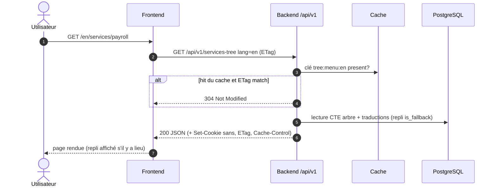

# 08 · API

> 🟡 **Statut : M3 — à faire valider.**
> Contrat REST des trois surfaces (public · espace client · back-office),
> format d'erreur standard, pagination, négociation de langue, cache,
> idempotence, rate limiting, et le livrable machine-lisible
> `openapi.yaml` (validé — voir § traces en bas de page).
> Alignement avec `Frontend/docs/api-contract.md` : §8.

## 1. Principes

| Principe | Décision |
|---|---|
| Style | REST, ressources nommées au pluriel, actions métier en sous-chemin (`…/publish`, `POST` dédiés — jamais de PUT profond) |
| Versionnage | Préfixe `/api/v1/` ; `v1` gelé à la première mise en production ; toute rupture = `/v2` parallèle avec fenêtre de coexistence (SC-5xx) |
| Surfaces | 1. `/api/v1/**` public (anonyme, read-only sauf contact) · 2. `/api/v1/client/**` espace client (auth client) · 3. `/api/v1/admin/**` back-office (auth RBAC) |
| Cohérence | mêmes conventions partout : JSON, ISO-8601 UTC (`Z`), UUID, codes de langue BCP-47 |
| Sécurité | cf. page 09 — cookies httpOnly + CSRF, permissions par (module, action, langue) |

Noms **figés** (contrat machine `openapi.yaml`, à ne pas renommer) :

| Canal | Nom | Notes |
|---|---|---|
| Cookie session | `session_id` | HttpOnly, Secure (prod), SameSite=Lax |
| Cookie CSRF | `csrf_token` | **non-HttpOnly**, même Domain / SameSite / Secure |
| En-tête CSRF | `X-CSRF-Token` | obligatoire sur mutations `/admin/**` hors login, forgot, reset, activate |

Émission du CSRF : login `authenticated`, activation, et `GET /admin/auth/me`.
Codes d'écart : `CSRF_TOKEN_MISSING`, `CSRF_TOKEN_MISMATCH` (403).
Longueur minimale des mots de passe : **14** (page 09). Création d'utilisateur : mot de passe optionnel (invitation à la place, Q-105).

## 2. Pagination, filtre, tri, champs sparse

- **Pagination** : **curseur** (`?cursor=<opaque>&limit=`, réponse
  `next_cursor`) sur toutes les listes publiques et la recherche — les
  publications/content sont réordonnés et insérés en continu : un offset
  est instable (éléments sautés/dupliqués). **Offset** (`page`, `limit`)
  toléré uniquement sur les tables d'administration stables (audit, logs),
  borné à `limit ≤ 100`.
- **Filtre** : verticalement `?status=published&category_id=…&lang=fr` ;
  recherche serveur (FTS — full-text) `GET /search?q=…`.
- **Tri** : `?sort=-published_at` (préfixe `-` = desc), restreint aux colonnes
  autorisées (liste contrainte, jamais d'injection SQL).
- **Champs sparse** : `?fields=id,slug,title` (projection, réduit la
  payload des listes et du mobile).

## 3. Négociation de langue

| Priorité | Source | Exemple |
|---|---|---|
| 1 | query `?lang=en` | `GET /api/v1/services-tree?lang=en` |
| 2 | en-tête `Accept-Language: en` | navigateur |
| 3 | langue par défaut de `languages` | fr |

- `lang` validé contre la table `languages` (404 `UNKNOWN_LANG` sinon —
  sécurité i18n, page 09).
- Toute réponse mono-langue porte `is_fallback: true/false` (repli explicite)
  et `alternate: {fr: "…", en: "…"}` ; sur une page sans équivalent, la
  réponse expose `fallback: {lang: "fr", href: "/fr/services/…"}` (H-009)
  à l'intention du lien « changer de langue » du frontend.
- **Back-office** : `?all_langs=1` retourne `by_lang: {fr: {...}, en: {...}}`
  + complétudes (édition côte à côte, EF-502/514).

## 4. Cache & invalidation

| Mécanisme | Détail |
|---|---|
| ETag | calculé sur la version de contenu published (hash `content_version`), réponse `ETag: "v-uuid"` ; `If-None-Match` → `304` |
| Cache-Control | publics : `public, max-age=60, stale-while-revalidate=300` ; private/auth : `no-store` |
| Invalidation | événement `ContentPublished/Unpublished/SettingUpdated` → purge des clés concernées + marquage sitemap `stale` (fig. 13, page 05) |
| Clés | `content:{type}:{id}:{lang}`, `tree:menu:{lang}`, `settings:public` |

## 5. Idempotence & rate limiting

- **Idempotency-Key** requis sur les écritures sensibles du public
  (`POST /contact`) et sur les publications/dépôts de fichiers côté
  admin/client ; la première clé 24 h est rejouée sans doubler
  (la réponse porte l'en-tête `X-Idempotent-Replayed: true`).
- **Rate limiting** (par IP + clé) : public : 60 req/min (contact : 5/10 min
  + honeypot + délai; client : 120/min ; admin : 120/min. Réponses `429` avec
  `Retry-After`.

## 6. Format d'erreur standard

`application/problem+json` (RFC 9457), toujours :

```json
{
  "type": "https://api.exauceac.com/errors/VALIDATION_ERROR",
  "title": "Requête invalide",
  "status": 422,
  "code": "VALIDATION_ERROR",
  "detail": "Le champ email est invalide.",
  "correlation_id": "01HV3M5B…",
  "errors": [{"field": "email", "code": "EMAIL_MALFORMED", "message": "Adresse invalide"}]
}
```

- `code` : identifiant **stable** (ne change jamais), documenté §6.1.
- `title`/`detail`/`message` : **traduits** selon la langue négociée (ADR-003).
- `correlation_id` : relayé dans les logs (ENF-601).
- Catalogues d'erreurs principales :

| code | HTTP | Contexte |
|---|---|---|
| `VALIDATION_ERROR` | 422 | payload invalide (déterminé par schéma) |
| `UNKNOWN_LANG` | 404 | code de langue inconnu/inactif |
| `CONTENT_NOT_FOUND` | 404 | slug/id inconnu ou draft non exposé |
| `REDIRECTED` | 301/302 | slug ancien → cible (EF-604) |
| `UNAUTHENTICATED` | 401 | identifiants invalides ou session absente |
| `SESSION_EXPIRED` | 401 | session idle expirée (30 min) ou vie max (8 h) |
| `MFA_REQUIRED` | 401 | code catalogue ; login admin : `200` + `status=mfa_required` |
| `FORBIDDEN` | 403 | permission (module/action/langue) insuffisante |
| `CSRF_TOKEN_MISSING` | 403 | mutation `/admin/**` sans en-tête `X-CSRF-Token` |
| `CSRF_TOKEN_MISMATCH` | 403 | `X-CSRF-Token` ≠ cookie `csrf_token` |
| `NOT_PERMITTED_LANG` | 403 | action interdite sur cette langue (RBAC L) |
| `INVALID_TRANSITION` | 409 | workflow éditorial, transition illégale |
| `CONFLICT` | 409 | verrou optimiste (version d'entité) |
| `RATE_LIMITED` | 429 | quota |
| `IDEMPOTENT_REPLAY_CONFLICT` | 409 | même clé, autre payload |
| `UPLOAD_REJECTED` | 415 | type/taille/contenu refusé |
| `IDOR_BLOCKED` | 404/403 | doc client non accessible (anti-IDOR, journalisé) |
| `TOKEN_EXPIRED` | 410 | invitation ou reset déjà utilisé / périmé |
| `NOT_IMPLEMENTED` | 501 | réservé ; la recherche admin v1 renvoie `200` `status=not_implemented` |
| `SERVER_ERROR` | 500 | inattendu (correlation_id obligatoire) |

## 7. Contrat par ressource

Légende : **A** anonyme · **C** client authentifié · **B** back-office
(role=permission). Tables utilisées : cf. dictionnaire page 06.

### 7.1 Surfaces publiques

| Endpoint | Description | Acteur | EF / UC | Tables |
|---|---|---|---|---|
| `GET /api/v1/services-tree` | arbre fermé des 4 niveaux (menu complet), par langue | A | EF-101, SC-101 / UC-001 | content_nodes, entity_translations |
| `GET /api/v1/familles/{slug}` | détail famille + domaines | A | EF-102 / UC-002 | content_nodes, translations |
| `GET /api/v1/domains/{slug}` | détail domaine + groupes + services, prev/next | A | EF-102 / UC-002 | idem |
| `GET /api/v1/intervention-types` | 2 types d'intervention | A | EF-103 / UC-003 | intervention_types, translations |
| `GET /api/v1/sectors` | 3 secteurs + 9 sous-cat (si `approved`) | A | EF-104 / UC-004 | sectors, translations |
| `GET /api/v1/publications` | liste publiée, filtres, pagination close | A | EF-105 / UC-005 | publications, categories, translations |
| `GET /api/v1/publications/{slug}` | détail (404 si draft) | A | EF-105 / UC-005 | idem |
| `GET /api/v1/pages/{key}` | pages éditoriales (about…légaux avec banner_pending) | A | EF-107/108 / UC-1x | pages, translations |
| `GET /api/v1/settings/public` | coordonnées, réseaux, SEO (cache court) | A | EF-106 / UC-010 | site_settings |
| `GET /api/v1/search` | FTS par langue | A | EF-201…204 / UC-006 | search_index, entity_translations |
| `POST /api/v1/contact` | soumission lead (idempotent, anti-abus) | A | EF-301…303 / UC-008 | leads, outbox_emails |
| `GET /sitemap.xml` · `/robots.txt` | sitemap dynamique | A | EF-701 / système | entity_translations, publications, pages |

### 7.2 Espace client (v2)

| Endpoint | Description | Acteur | EF / UC | Tables |
|---|---|---|---|---|
| `POST /api/v1/client/auth/activate` | activation via invitation signée | C | EF-401 / UC-020 | client_invitations, client_users |
| `POST /api/v1/client/auth/login` (+ `…/mfa` | connexion (+ MFA) | C | EF-402 / UC-021 | client_users, sessions |
| `POST /api/v1/client/auth/password-forgot` `…/reset` | réinitialisation | A | EF-402 / UC-022 | client_users |
| `GET /api/v1/client/documents` | documents de MON compte (anti-IDOR) | C | EF-403 / UC-023 | client_documents |
| `GET /api/v1/client/documents/{id}/download` | stream signé court ; contrôle de possession | C | EF-403 / UC-024 | client_documents, audit_log |
| `GET/PUT /api/v1/client/profile` | profil, langue préférée | C | EF-402 / UC-025 | client_users |
| `POST /api/v1/client/data-request` | export/suppression (CDP) | C | EF-405 / UC-026 | consents, outbox_emails |

### 7.3 Back-office (extraits ; rôles = permission module×action×langue)

| Endpoint | Description | Rôle min. | EF / UC | Tables |
|---|---|---|---|---|
| `POST /api/v1/admin/auth/login` (+ MFA) | connexion ; `200` `authenticated` \| `mfa_required` | — | EF-501 / UC-043 | users, sessions |
| `POST /admin/auth/logout` | révocation session | session | EF-501 | sessions |
| `GET /admin/auth/me` | utilisateur + permissions + `csrf_token` | session | EF-502 | users, roles, permissions |
| `POST /admin/auth/password-forgot` | demande reset (toujours 202) | — | EF-501 | users, outbox_emails |
| `POST /admin/auth/password-reset` | nouveau mot de passe (jeton signé) | — | EF-501 | users, sessions |
| `POST /admin/auth/password-change` | changement (session, `must_reset_password`) | session | EF-501 | users |
| `POST /admin/auth/activate` | activation invitation (Q-105) | — | EF-513 | users |
| `GET /admin/reports/dashboard` | agrégats tableau de bord | view | EF-512 / UC-04x | agrégats |
| `GET/POST /admin/publication-jobs` | historique / déclenchement SSG | view / publish | EF-506 | publication_jobs |
| `GET /admin/publication-jobs/current` | état navbar (à jour / pending / building / failed) | view | EF-506 | publication_jobs |
| `GET /admin/publication-status` | SSE `publication.job` + `heartbeat` | view | page 17 | publication_jobs |
| `GET /admin/notifications` `POST …/{id}/read` | notifs leads | crm | EF-304 | leads |
| `GET /admin/search` | **à venir** — stub `status=not_implemented` | session | — | — |
| `GET/POST/PATCH /admin/users` · `…/{id}/deactivate` | utilisateurs (password optionnel → invitation) | admin | EF-513 / UC-043 | users, roles, sessions |
| `GET/POST /admin/roles` ` /permissions` | rôles et permissions | super_admin | EF-502 / UC-043 | roles, permissions |
| `GET/POST/PATCH /admin/languages` | langues (activate…) | super_admin | EF-602 / US-009 | languages |
| `GET /admin/content-tree` `POST /admin/content-tree` | lecture/écriture arbre | editor→admin | EF-508 / UC-041 | content_nodes |
| `POST /admin/tree/{id}/move` `…/merge` `…/reorder` | opérations arbre | admin | EF-508 / UC-041 | content_nodes |
| `GET/POST/PATCH/DELETE /admin/content/{type}/{id}` | CRUD pages/publications/node | editor | EF-501… / UC-030 | pages, publications, nodes |
| `PUT /admin/content/{type}/{id}/translation/{lang}` | écriture d'une traduction | editor (du à cette langue) | EF-601 / UC-031 | entity_translations |
| `POST /admin/content/{id}/submit-review` `…/approve` `…/reject` | workflow de relecture | reviewer | EF-503 / UC-032/033 | entity_translations |
| `POST /admin/content/{id}/publish` `…/unpublish` `…/schedule` | publication | admin | EF-506 / UC-040 | publications, cache |
| `GET /admin/content/{id}/versions` `POST …/restore` | versions | editor | EF-505 / UC-035/036 | content_versions |
| `GET/POST /admin/media` `DELETE /admin/media/{id}` | médiathèque | editor/admin | EF-801… / UC-042 | medias, media_refs |
| `GET/POST /admin/leads` `…/{id}/status` ` …/notes` | leads | crm | EF-304… / UC-050…053 | leads, lead_notes |
| `GET /admin/leads/export.csv` | export CSV | crm/admin | EF-305 / UC-048 | leads |
| `GET/POST /admin/clients` ` …/{id}/documents` | clients et docs | crm | EF-403 / UC-054/055 | client_* |
| `GET/PUT /admin/settings` | paramètres du site (contact…) | admin | EF-510 / US-008 | site_settings |
| `GET/POST /admin/redirects` | redirections | admin | EF-511 / UC-045 | redirects |
| `GET /admin/audit` | journal d'audit (lecture) | admin | EF-901 / UC-046 | audit_log |
| `GET /admin/reports/dashboard` | statistiques + complétude i18n | admin | EF-512 / UC-04x | agrégats (audit, translations) |
| `GET /api/v1/languages/active` | langues actives publiques (menus, sélecteur) | A | EF-602 | languages |

### 7.4 Exemples JSON clés

```json
// GET /api/v1/services-tree?lang=en (extrait)
{
  "lang": "en", "default_lang": "fr",
  "families": [
    {
      "id": "0b3…", "slug": "support", "title": "Support",
      "is_fallback": false,
      "domains": [
        {
          "id": "a1c…", "slug": "governance", "title": "Governance",
          "is_fallback": false,
          "groups": [{"id": "d2e…", "slug": "partners-level", "title": "Partners level"}]
        }
      ]
    }
  ],
  "alternate": {"fr": "/fr/services/accompagnement", "en": "/en/services/support"},
  "fallback": null
}
```

```json
// POST /api/v1/contact (requête)
{
  "name": "Awa Diop", "email": "awa@example.com", "phone": "+221 77…",
  "subject": "Audit", "message": "Bonjour…", "lang": "fr",
  "honeypot": "", "elapsed_ms": 8400
}
// 202 Accepted
{"id": "…", "status": "new"}  // Idempotency-Key acceptée
```

## 8. Alignement avec `Frontend/docs/api-contract.md`

| Zone | Contrat actuel (frontend) | Contract cible (08) | Plan de réconciliation |
|---|---|---|---|
| base path | `/api/services` | `/api/v1/…` (versionné) | le frontend ajoute le préfixe avant la bascule (page 13) |
| shape du contenu | `title: {fr, en}` dans payload | payload mono-langue + `is_fallback` + `alternate` | adaptateur côté frontend (fonction `translatePath` déjà isolée) |
| coordonnées | constantes `ORGANIZATION` en dur | `GET /settings/public` | lecture asynchrone, fallback constantes tant que non basculé |
| slugs | table `PAGE_SLUGS` locale | `alternate` + `fallback` par l'API (H-009) | l'API devient source (seed parité page 13) |
| site| statique (30 URLs) | `GET /sitemap.xml` dynamique | équivalent l'altitude entre base et fichier |
| recherche | client local | `GET /search` | bascule à M5 |

## 9. Traçabilité (endpoints ↔ exigences ↔ tables ↔ tests)

Chaque ligne de §7 porte : EF- (exigence), UC- (cas d'usage), SC-
(scénario, page 04), et table ; la colonne **rôle** est la permission
effectivement exigée (module/action/langue). Extraits de vérification :

| Endpoint | EF | UC | SC | Tables | Rôle | Test |
|---|---|---|---|---|---|---|
| `POST /contact` | EF-301…303 | UC-008 | SC-301…303 | leads, outbox | — | API tests + e2e |
| `GET /services-tree` | EF-101, EF-603 | UC-001 | SC-101 | nodes, translations | — | API tests + parité seed |
| `GET /search` | EF-201…204 | UC-006 | SC-201…203 | search_index | — | FTS fixtures |
| `POST /admin/content/{id}/publish` | EF-503, 506 | UC-040 | SC-523 | translations + cache | permission publish | tests d'intégration |
| `GET /client/documents/{id}/download` | EF-403 | UC-024 | SC-404 | client_documents, audit | client du compte (IDOR test) | test sécurité |
| `PUT /admin/content/{type}/{id}/translation/{lang}` | EF-601, EF-502 | UC-031 | SC-530 | translations, versions | editor (cette langue) | permissions par langue |

## 10. Diagramme — flux d'une requête publique



*Figure 1 : chaîne complète — cache, ETag, repli explicite (EF-603, H-009).*
