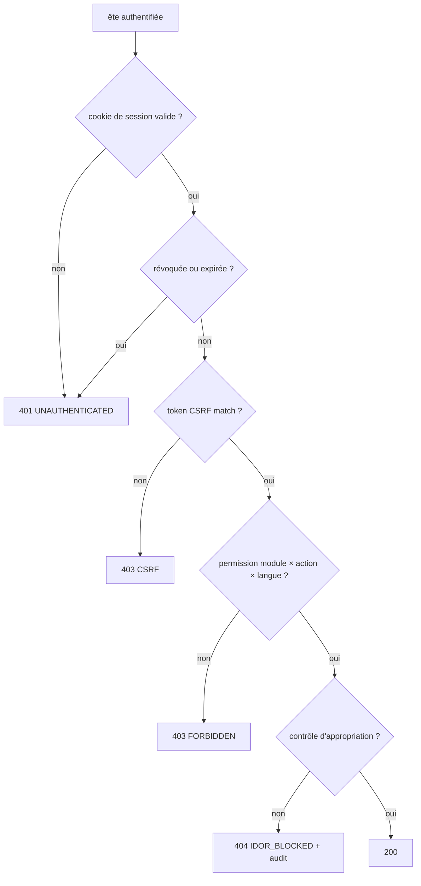

# 09 · Sécurité et conformité

> 🟡 **Statut : M3 — à faire valider.**
> Modèle de menaces STRIDE par composant, authentification (ADR-004),
> autorisation RBAC + anti-IDOR, protection des données, uploads, contenu
> riche & en-têtes, anti-abus, matrices OWASP/ASVS, conformité CDP
> (loi n° 2008-12) — **tous les points juridiques sont marqués
> « À VALIDER JURIDIQUEMENT », aucun texte juridique n'est rédigé** —
> et sécurité propre au multi-langue.

## 1. Modèle de menaces (STRIDE) par composant

| Composant | Spoofing | Tampering | Repudiation | Info disclosure | DoS | Elevation |
|---|---|---|---|---|---|---|
| Frontend (publieur) | phishing/jeu de faux pages : mitigé par CSP et logo/canonical | XSS via contenus : assainissement serveur | (n/s) | (n/a) | charge côté CDN | (n/a) |
| API publique | usurpation IP mitigée par rate limit | manipulation slug : validation stricte de format | logs de êtes | is_fallback ne révèle pas plus que public | rate limit + cache | surface de lecture seule |
| API espace client | session client spoof : cookie httpOnly+SameSite+Secure | IDOR doc client : contrôle d'appartenance (SC-404) | le téléchargement est audité | lien signé à durée courte | rate limit | _surface isolée | aucune écriture autre que profil |
| API back-office | spoof sessions : TOTP + lockout | modification contenus : RBAC + versions | complet audit immuable | journalisé | rate limit | élévation testée (SC-510) |
| PostgreSQL | (réseau interne uniquement) | écritures directes interdites : rôles PG restreints | journalisation des accès | chiffrement au repos (LUKS) | réseau fermé | rôles PG distincts `app`, `monter` |
| Stockage fichiers | renommage forcé (clé UUID) | ClamAV + magic bytes | Téléchargements audités | stockage hors webroot ; URL signées courtes | taille limitée | permissions de volume |
| E-mail (SMTP relay) | expéditeur falsifié : SPF/DKIM/DMARC | template versionnés (ADR-003) | outbox journalisé | pas de secret via mailto dans mailto | outbox rate | (n/a) |
| CI/CD | secrets jamais dans le repo | pipeline signant les images | logs pipeline | secrets via variables protégées | runners éphémères | accès mainteneurs |
| Hébergement (VPS Debian) | SSH par clé ; 2FA sur le panel | maj auto de sécurité | journald persistant | LUKS disque | firewall, fail2ban | pas de sudo applicatif |

*Figure 1 : matrice STRIDE synthétique ; chaque cellule correspond à une
mesure concrète mise en œuvre (endpoints 08, tables 06).*

## 2. Topologie domaines/sous-domaines et cookies (ADR-009)

```admonition success title="ADR-009 · Même origine via reverse proxy (www unifie tout)"
**Contexte** : trois applications cohabitent (frontend public, espace
client, back-office) ; l'authentification repose sur des cookies (ADR-004)
qui doivent protégés contre les fuites entre sous-domaines ; le CORS doit
rester minimal ; le développement local doit être simple.

**Options** :
- *O1 — mêmes origines via reverse proxy* : `exauceac.com` (frontend),
  `exauceac.com/admin` (back-office), `exauceac.com/api/…` (API) —
  tout est même origine ;
- *O2 — sous-domaines* : `www`, `admin`, `api` — il faut CORS + cookies
  `Domain=.exauceac.com` (partagés entre sous-domaines = surface plus
  large en cas de XSS, impossible d'utiliser le préfixe `__Host-`, CSRF
  plus délicat à la frontière des origines) ;
- *O3 — domaines distincts* — encore pire (cookies tiers, SameSite=None).

**Décision : O1 (recommandation retenue)** — reverse proxy (Traefik ou
Caddy, page 11) qui route `/api/**` vers FastAPI et `/admin` vers la SPA
back-office :
- cookies `Secure`, `HttpOnly`, `SameSite=Lax`, **`__Host-` prefix**,
  `Domain` omis (host-only) — la portée la plus étroite possible ;
- **aucun CORS à configurer** (même origine) — une seule politique à
  maintenir ;
- CSRF double-submit inchangé (le cookie CSRF et l'en-tête sont
  origin-native) ;
- développement local : `localhost:5173` (Vite) proxifie `/api` et
  `/admin` vers le compose (configuration dev fournie).

**Conséquences** : le H-STS `includeSubDomains` est sûr (pas de
sous-domaine hostile) ; le déploiement exige une entrée Traefik par
service interne, invisible de l'extérieur.
```

## 2. Authentification

```admonition success title="ADR-004 · Sessions cookie httpOnly (+ CSRF), jamais de jeton localStorage"
**Options** : (a) cookies httpOnly `SameSite=Lax` + jeton CSRF par double
envoi ; (b) Bearer tokens en localStorage (SPA classique) ; (c) OIDC
externe.

**Décision** : **(a)** pour l'admin et l'espace client — cookies
`Secure`, `HttpOnly`, `SameSite=Lax`, durée d'idle 30 min / vie max 8 h,
**rotation à chaque élévation de privilège** (login MFA, changement de
rôle), révocation immédiate côté serveur (`sessions.revoked_at`).
Justification : le frontend (SPA) et l'API restent sous le même domaine
front+API sur le même hôte ; CSRF protégé par le token double-submit +
`SameSite=Lax` ; les axes (b) exposent les jetons en XSS. (c) exclus :
aucune dépendance SaaS (H-002).
```



*Figure 2 : chaîne d'autorisation — chaque étape échoue en silence sur les
données void (pas de fingerprint d'utilisateur existant, cf. §2.2).*

### 2.1 Back-office

- **MFA TOTP** : **obligatoire** pour tout rôle autorisant publier,
  exporter des leads, gérer des utilisateurs ou accéder aux documents
  clients (admin, crm, super_admin) ; optionnelle pour un rôle de
  consultation. Toute exception est une décision documentée (ADR + date +
  signature du cabinet) — jamais un silencieux de défaut (fig. 12 p05 — accepté EF-501).
- **Mot de passe** : Argon2id aux paramètres recommandés par l'OWASP ;
  longueur minimale 14 caractères (ou passphrase de 4 mots) ; aucune
  question secrète.

### 2.2 Anti-énumération & verrouillage

- Message identique pour « compte inconnu » et « mot de passe erroné ».
- Verrouillage proportionnel après 5 échecs (5 min, ×2 exponentiel, plafonné à 1 h),
  journalisé.
- **Réinitialisation** : lien signé HMAC, 1 h, usage unique, révocation
  des sessions existantes acceptées ; jamais d'indication d'existence de compte.

### 2.3 Invitation des clients (v2)

- Invitation = token HMAC signé par compte, TTL 7 jours, usage une fois,
  **aucune route d'inscription publique** (EF-401) ; activation définie
  mot de passe + MFA optionnel.

## 3. Autorisation

- **RBAC** : permission = (module × action × langue) — page 05 §2.3, la
  matrice fonctionnelle au M4 (page 10).
- **Contrôle d'accès objet (anti-IDOR)** : toute lecture/écriture d'une
  ressource client vérifie l'appartenance du compte (fig. 15 p05) — le
  test IDOR est dans la suite de sécurité (page 12).
- Les **tests d'autorisation** (matrice rôle → endpoint attendue) sont
  générés du contrat OpenAPI (chaque endpoint declare `x-permission`).

## 4. Protection des données

| Sujet | Mesure |
|---|---|
| Transit | TLS 1.2+ partout (cert bot auto-renew), HSTS 1 an avec preload |
| Repos | disque chiffré (LUKS) ; sauvegardes chiffrées hors serveur (ENF-701) |
| Mots de passe | Argon2id (jamais bcrypt/md5/SHA) |
| Secrets | variables d'environnement Docker secrets ; jamais dans le repo ; rotation |
| Audit | `audit_log` append-only (qui/quoi/quand/IP/avant-après) — fig. 9 p06 |
| Pseudonymisation | leads anonymisés au terme de la rétention (EF-307) ; comptes clients anonymisables (EF-405) |
| Accès données client | chaque consultation/téléchargement audité (qui, quand) — US-014 |
| Rétention | paramétrable (`site_settings.retention`) ; job quotidien |

## 5. Uploads

| Mesure | Détail |
|---|---|
| Types | whitelist : PNG/JPEG/WEBP/PDF (+ ZIP clients v2, à discuter) |
| Taille | configurable, par défaut images 5 Mo, PDF 20 Mo, docs l'upload 10 Mo |
| Validation | magic bytes + double extension bloquée, MIME fixé (EF-801) |
| Renommage | clé de stockage UUID (jamais le nom original dans l'URL) |
| Emplacement | hors racine web ; servi uniquement par l'API (stream contrôlé) |
| Antivirus | **ClamAV** à l'upload (échec ⇒ rejet + alerte) ; scan différé si lourd |
| Accès | documents clients : **URL signées à durée courte** (5 min), re-check anti-IDOR à chaque téléchargement |

## 6. Contenu riche, XSS, en-têtes

- **Formats** : Markdown assaini côté serveur (whitelist : gras, italique,
  listes, tableaux, liens http(s), images dans la médiathèque seulement) —
  ADR-005 (page 14).
- Assainissement (bleach/DOMPurify côté serveur strict) : pas de script,
  iframe, style ou attribute événement handler.
- **En-têtes** (toutes les réponses du backend) :

| En-tête | Valeur |
|---|---|
| Content-Security-Policy | `default-src 'self'; img-src 'self' data:; script-src 'self'; style-src 'self' 'unsafe-inline'(fonts hébergées)` |
| X-Content-Type-Options | `nosniff` |
| X-Frame-Options | `DENY` |
| Referrer-Policy | `strict-origin-when-cross-origin` |
| Permissions-Policy | camera=(), microphone=(), geolocation=() |
| Strict-Transport-Security | `max-age=31536000; includeSubDomains; preload` |

## 7. Anti-abus

| Mesure | Détail |
|---|---|
| Rate limiting | par surface (08 §5) ; `429 + Retry-After` |
| Honeypot | champ invisible dans le formulaire (rempli ⇒ réjet silencieux) |
| Délai minimal | `elapsed_ms` < 3 s ⇒ rejet (bot) |
| Captcha | respectueux de la vie privée (Turnstile/hCaptcha) en option — **Q-007**, décalé hors v1 (défaut hors) |
| Scraping | robots.txt raisonnable + rate limit global ; pas de mesure agressive (le cabinet veut être visible) |
| Double soumission | Idempotency-Key (08 §5) |

## 8. Matrices OWASP / ASVS

| OWASP Top 10 (2021) | Mesure | ENF/EF | Test |
|---|---|---|---|
| A01 Broken Access Control | RBAC + anti-IDOR + tests matriciels | EF-502, EF-403 | SC-404, SC-510 |
| A02 Cryptographic Failures | Argon2id, TLS, LUKS, backups chiffrés | ENF-301 | revue + scan |
| A03 Injection | ORM paramétré, Markdown assaini, FTS to_tsquery échappé | EF-507 | injection suite |
| A04 Insecure Design | modélisation STRIDE + ADR | cette page | revue |
| A05 Misconfiguration | en-têtes (§6), environnements distants sécurisés, secrets hors dépôt | page 11 | scanneur d'en-têtes |
| A06 Vulnerable Components | versions figées (irements), scan npm/pip en CI | page 12 | pip-audit |
| A07 Identification Failures | ADR-004, MFA, verrouillage | EF-501 | SC-501 |
| A08 Software/Data Integrity | images Docker signées, pipeline | page 11 | CI |
| A09 Logging Failures | audit immuable, alertes (EF-903) | EF-901 | test audit |
| A10 SSRF | aucun fetch serveur appelé par l'utilisateur — Wn't en v1 (pas d'import d'URL) | — | code review |

**ASVS niveau cible : L2** — justification : application publique avec
Espace client contenant des données personnelles de clients d'un cabinet comptable,
au sein d'une petite équipe — L3 concerne les grands organismes présentant
critiquables (banques, e-gov) et alourdirait v1.

## 9. Conformité CDP (loi n° 2008-12) — À VALIDER JURIDIQUEMENT

| Sujet | Exigence fonctionnelle | Mesure proposée | Statut |
|---|---|---|---|
| Registre des traitements | EF-1001 | doc interne + tables correspondantes (consents, leads, audit) | À VALIDER JURIDIQUEMENT |
| Consentement | EF-1002, EF-109 | registre horodé des consentements cookies/formulaires ; révocable | À VALIDER JURIDIQUEMENT |
| Droit d'accès / portabilité | EF-1003, EF-405 | export JSON/ZIP des données personnelles ; SLA 30 j | À VALIDER JURIDIQUEMENT |
| Rectification / effacement | EF-1003 | workflows back-office (édition, anonymisation) | À VALIDER JURIDIQUEMENT |
| Durées de retention | ENF-702 | leads 24 mois (défaut), purge quotidien ; audit 3 ans (à valider) | À VALIDER JURIDIQUEMENT |
| Transfert hors Sénégal | — | hébergement local (Dakar, à confirmer) — Q-008 | À VALIDER JURIDIQUEMENT |
| RGPD (ressortissants UE) | — | principe : mêmes principes que CDP + droits (accès/effacement/portabilité) — si le cabinet détecte des obligations CE | À VALIDER JURIDIQUEMENT (Q-001) |

**Rappel structurel** : aucune mention légale, politique de confidentialité
ou politique de cookies n'est rédigée ici ; le *bloqueur de mise en ligne*
RB-001 (page 01) exige la validation par le cabinet/juriste avant mise en
production.

## 10. Sécurité propre au multi-langue

| Risque | Mesure |
|---|---|
| Code de langue inconnu injecté (`?lang=<script>`…) | whitelist `languages` ; 404 `UNKNOWN_LANG`, jamais répercuté sans échappement |
| Slug/hreflang injection | slugs générés par l'API, format contraint `[a-z0-9-]`, jamais de path traversal |
| Langue désactivée exposée | URLs de langue désactivée → 301 vers la langue par défaut (L4, page 07) |
| Draft exposé via une langue | lecture publique : uniquement `status='published'` **par langue** (ête 08 §2.2 COALESCE) — un brouillon EN n'expose jamais le texte d'un draft |
| Provider de traduction externe | HORS périmètre v1 (ADR-003/TR-fb) ; si retenu plus tard, aucun contenu client ne part vers un service tiers |

## 11. Traçabilité STRIDE → mesure → exigence

| Menace (extrait) | Mesure | Exigence | Scénario/test |
|---|---|---|---|
| Force brute sur login | lockout exponentiel + MFA | EF-501 | SC-501 |
| Élévation de privilèges | RBAC strict + tests générés | EF-502 | SC-510 |
| IDOR documents | contrôle d'appartenance à chaque accès | EF-403 | SC-404 |
| XSS via contenus | assainissement serveur + CSP | EF-507 | SC-524 |
| Upload malveillant | whitelist + ClamAV + storage isolé | EF-801 | SC-801 |
| Spam formulaire | honeypot + rate limit + délai | EF-303 | SC-303 |
| Énumération de comptes | messages uniformes | EF-501 | SC-502 |
| CSRF | SameSite=Lax + double-submit | ENF-301 | test CSRF |
| Fuite par cache privé | `no-store` sur authés | page 08 | test ETag |
| Indisponibilité de la DB | mode dégradé read-only (page 11) | ENF-202 | SC-5xx |
