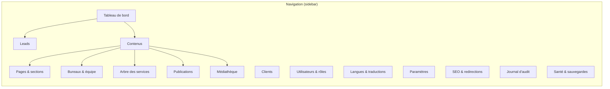

# 10 · Back-office

> 🟡 **Statut : M4 — à faire valider.**
> Objectifs, rôles et matrice de permissions (module × action × **langue**),
> cartographie des écrans, workflow éditorial, éditeur de contenu, modules
> fonctionnels, choix technique (ADR-008) et accessibilité/i18n.

## 1. Objectifs et principes

1. **L'édition intégrale du contenu public** — y compris les coordonnées du
   cabinet (téléphones fixes/mobiles, e-mail, adresse postale, réseaux
   sociaux) : aucune valeur affichée par le frontend n'est codée en dur
   (EF-001, EF-106).
2. Zéro intervention technique pour publier : workflow → publication →
   cache/sitemap gérés automatiquement (fig. 13 p05).
3. L'utilisateur visé est non-technicien (le fondateur, H-001) : chaque
   écran affiche un état vide utile, des erreurs explicites ; aucune
   rédaction n'est perdue (versions + verrou optimiste).
4. i18n : édition côte à côte FR/EN, complétude affichée, permissions par
   langue (H-001).

## 2. Rôles, permissions, matrice

Les rôles sont semés (06 §2.3) ; la matrice acteurs × rôles de la page 03 (§5) donne la vue d'ensemble. L'opération effective = permission
`(module, action, langue)`.

| Module (`permissions.module`) | Actions possibles | Rôle par défaut | Langue-scopable | MFA |
|---|---|---|---|---|
| `pages` — Pages & sections (accueil, à propos, légaux, 404…) | view/create/edit/review/publish/delete | editor (edit), reviewer (review), admin (publish) | ✅ | oui (publish) |
| `tree` — Arbre des services | view/create/edit/move/merge/delete | admin | ✅ | non |
| `publications` — Publications & catégories | view/create/edit/review/publish/delete | editor / reviewer / admin | ✅ | oui (publish) |
| `media` — Médiathèque | view/create/edit/delete | editor | ❌ (média partagé) | non |
| `leads` — Leads | view/edit/status/notes/export/anonymize | crm | ❌ | oui (export) |
| `clients` — Clients & documents | view/create/edit/delete/upload | crm | ❌ | oui |
| `users` — Utilisateurs & rôles | view/create/edit/delete/deactivate | admin / super_admin | ❌ | oui |
| `languages` — Langues & traductions | view/activate/deactivate | super_admin | (action globale) | non |
| `offices` — Bureaux et coordonnées | view/create/edit/delete/deactivate | admin | ✅ | non |
| `team` — Équipe & fondateur | view/create/edit/delete/deactivate | admin | ✅ | non |
| `settings` — Paramètres du site (identité, CTA, cookies) | view/edit | admin | ✅ (valeurs traduites) | non |
| `seo` — SEO / redirections | view/create/edit/delete | admin | ✅ | non |
| `audit` — Journal d'audit | view/export | admin | ❌ | oui (export) |
| `backup` — Sauvegardes / santé | view/run | super_admin | ❌ | oui |

*Table 1 : base de la matrice, détaillée en vue des besoins (mocks du
tableau de bord au §6). Toute action impossible est invisible, pas grisée. **MFA TOTP
obligatoire** pour tout rôle donnant accès à : publier, exporter les
leads, gérer des utilisateurs, accéder aux documents clients (colonne
« MFA » ci-dessous — EF-501, EF-502).*

## 3. Cartographie des écrans (plan)



*Figure 1 : navigation (sidebar) ; le tableau de bord agrège leads et
complétude de traduction.*

| Écran | Fonctions clés | États gérés (vide / chargement / erreur / conflit) |
|---|---|---|
| Tableau de bord | derniers leads, contenus à relire, complétude i18n, santé | squelettes de chargement, alertes de santé |
| Contenus — liste | filtres type/statut/langue/traduction manquante, recherche | filtre « à traduire » (EF-514) |
| Contenus — éditeur | titre/intro/corps par langue, SEO, slug (+ conflit) | bandeau de conflit 409 (verrou optimiste EF-505) |
| Pages & sections | les 11 pages ; éditeur de blocs (ajouter, réordonner, activer/désactiver), aperçu FR/EN, SEO par page, `og_media_id` | état vide (aucun bloc), conflit 409, page système non supprimable |
| Bureaux & équipe | bureaux (un seul siège), téléphones/e-mail/carte, photos via médiathèque ; fiches équipe (un seul fondateur), biographie | refus de suppression du siège ou du fondateur sans remplaçant |
| Arbre des services | drag & drop, ajout, fusion, suppression (refus explicite si enfants) | confirmation, prévisualisation des redirections à créer |
| Publications | workflow + planification par langue | calendrier du planning, conflit de dates |
| Médiathèque | upload (barre), remplacement, aperçu, usage (media_refs) | refus type/taille/AV (SC-801) |
| Leads | liste kanban (statuts), fiche + notes, affectation, export CSV | export en cours, rétention |
| Clients | comptes, invitations, dépôt de documents | états invité/suspendu |
| Utilisateurs | invitations, activation/désactivation, rôles, MFA | sessions actives révocables |
| Langues | liste, activation, direction RTL, défaut | avertissement : désactivation ⇒ redirections |
| Paramètres | identité (nom légal, tagline), CTA partagés, bandeau cookies, modules actifs, SEO global, rétention | validation par schéma + audit |
| SEO/redirections | table `redirects`, aperçu des 301 automatiques | test d'URL intégré |
| Journal d'audit | filtres (acteur, action, entité, date), export | pagination offset |
| Santé & sauvegardes | état des services, dernière sauvegarde, restauration en 2 clics | procédure guidée (ENF-701) |

*Wireframe basse fidélité type (éditeur de contenu, 2 colonnes) :*

| Colonne gauche (arborescence) | Colonne droite (édition) |
|---|---|
| Filtre : type / statut / langue | Onglets : Contenu · SEO · Historique · Révisions |
| Arbre cliquable + badges de complétude | Langue actuelle en onglet (FR \| EN) ; bandeau « traduction obsolète » si `stale` |
| Bouton « + nouveau » | Boutons : Enregistrer · Soumettre à relecture · ← versions |

## 4. Workflow éditorial (états, transitions, notifications)

Le diagramme d'états est en page 05 (fig. 17). Tableau des règles :

| Transition de → à | Qui | Effets |
|---|---|---|
| draft → in_review | rédacteur | notification au relecteur (in-app) |
| in_review → approved | relecteur | verrou d'édition de la version relecture |
| in_review → draft | relecteur (rejet) | motif requis, conservé (versions) |
| approved → scheduled / published | admin | publication = invalidation cache + sitemap fig. 13 p05 |
| scheduled → published | système (planificateur) | à ± 1 min (SC-523) |
| published → unpublished | admin | sortie du sitemap + 301 parent (H-007 pour légaux) |
| toute → archived | admin | contenu retiré de tout flux, versions conservées |

Notifications in-app : relecture demandée/approuvée/rejetée, lead affecté,
document client déposé, échec d'e-mail outbox (EF-903), conflit d'édition.

## 5. Éditeur de contenu

- **Format** : Markdown assaini (ADR-005) avec en plus : barre d'outils
  limitée (gras/italique/listes/tableaux/lien/image-de-la-médiathèque),
  aucune injection HTML directe (sécurité, page 09 §6).
- **Slugs** : prévisualisation de l'URL publique par langue ; changement
  ⇒ proposition de redirection affichée (US-005).
- **Pages composées** : l'accueil et les pages éditoriales s'éditent comme
  une pile de blocs (`page_sections`) — ajout depuis le catalogue
  `section_types`, réordonnancement, activation/désactivation, textes par
  langue, réglages non traduits dans `config` (limite, variante, média,
  cible). Un type inconnu est impossible (FK). Les pages `is_system`
  (accueil, 404, légaux) ne peuvent pas être supprimées, seulement
  éditées ; un bloc désactivé n'est pas servi mais reste versionné.
- **Textes partagés** : le texte d'introduction « À propos » est aujourd'hui
  réutilisé par l'accueil ; en v1 le seed le duplique et l'éditeur affiche
  un avertissement (« ce texte existe aussi sur la page À propos »), la
  résolution par référence étant l'alternative documentée (doc 16 §10).
- **SEO par page** : seo_title (avec compteur 60), seo_description
  (compteur 160), OG image au choix de la médiathèque (défaut : logo).
- **Aperçu draft** : bouton « prévisualiser » → lien signé expirable 1 h
  (EF-504), par langue.
- **Verrou optimiste** : champ `updated_at` renvoyé en réponse ; toute
  sauvegarde fondée sur une version périmée ⇒ 409 + copie de la version
  distante proposée (SC-522).

## 6. Tableau de bord (métriques v1)

- Leads (statuts, ancienneté) · contenus en attente de relecture ·
  complétude i18n (par rubrique) · santé (sauvegarde, disque, outbox en
  échec).
- Vues de publications : compteur simple (EF-512), sans suivi de
  personnes. Aucun analytics tiers v1 (H-011 : pas de GA v4 — à confirmer
  si un jour souhaité).

## 7. Choix technique (ADR-008)

```admonition success title="ADR-008 · React + Vite + Tailwind (aligné sur le frontend), composants partagés — pas d'générateur d'admin prêt-à-l'emploi"
**Options** :
- *O1* — React + Vite + Tailwind, même stack que le frontend ;
- *O2* — Framework d'admin existant (Django Admin, React
- Admin, Directus…) : rapide à démarrer, personnalisation du workflow
  i18n et RBAC possible mais plafonnée.

**Décision** : O1. Justifications :
- le périmètre a des formes spécifiques (édition côte à côte, arbre
  drag & drop, complétude de traduction, permissions par langue) peu
  représentées dans les admins génériques ;
- mutualisation forte avec le frontend existant : **design tokens**
  Turquoise/ivoire déjà en place, composants Tailwind partagés, types
  générés depuis OpenAPI (openapi-typescript — ENF-502) ;
- le fondateur a une seule app à comprendre ( même DOM, même RTL).

**Perte acceptée** : plus de code interne ; compensation : design
tokens partagés dans un package `@exauce/ui` (package interne privé),
qualité contraste/keyboard accessible dès la componente de base.
```

## 8. Accessibilité et i18n de l'interface

- **WCAG 2.1 AA** (ENF-401) : contrastes ≥ 4.5:1, focus visible,
  navigation clavier complète (drag & drop avec alternative clavier par
  boutons déplacer-haut/bas), libellés explicites, erreurs formulaires
  associées aux champs (aria-describedby).
- **Langue de l'interface** : FR complète au MVP, EN ensuite (ENF-801) ;
  RTL possible pour l'interface (miroirs CSS) si une langue RTL s'active
  (EF-605).
- Dates/heures affichées en `Africa/Dakar`.
