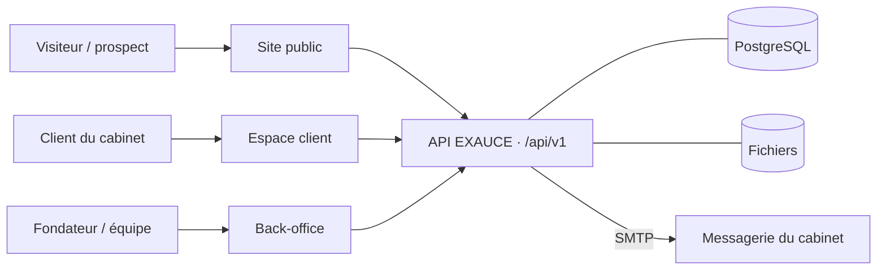
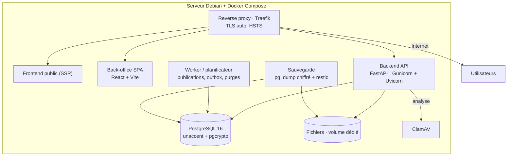
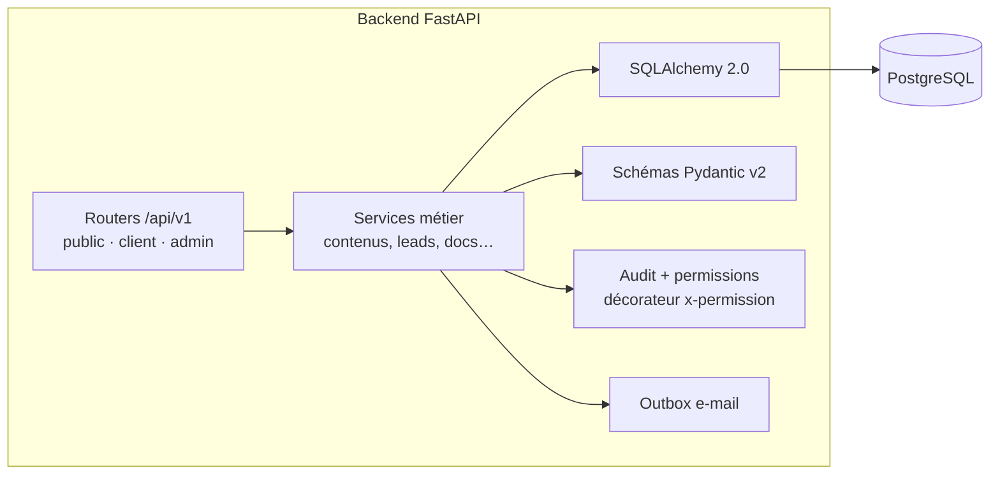

# 11 · Architecture et déploiement

> 🟡 **Statut : M5 — à faire valider.**
> Vues C4 (contexte, conteneurs, composants), Docker Compose,
> environnements, CI/CD, observabilité, sauvegarde avec RPO/RTO,
> stockage des fichiers (ADR-011), e-mail transactionnel, hébergement
> (Q-008), migrations sans interruption, plan de reprise.

## 1. Vues C4

### 1.1 Contexte (niveau 1)



*Figure 1 : contexte — 3 acteurs, 3 interfaces, 1 API, 3 dépendances.*

### 1.2 Conteneurs (niveau 2)



*Figure 2 : conteneurs — un seul compose, pas d'orchestrateur (H-002) ;
le worker partage l'image du backend.*

### 1.3 Composants du backend (niveau 3)



*Figure 3 : composants — chaque route déclare sa permission ; le
décorateur applique la matrice (page 10) systématiquement.*

## 2. Déploiement Docker Compose (extrait)

```yaml
services:
  proxy:   # Traefik v3 — TLS Let's Encrypt, HSTS, routage /api et /admin
  api:     # FastAPI — image unique, uvicorn workers
  worker:  # même image, commande worker (APScheduler / ARQ)
  db:      # PostgreSQL 16, volume dédié, healthcheck pg_isready
  clamav:  # antivirus, réseau interne uniquement
  backup:  # cron : pg_dump -Fc chiffré, puis restic hors site
volumes:
  db-data:
  exauce-files:   # monté hors racine web
```

*Extrait illustratif ; le compose complet vivra dans le dépôt Backend
(M6+). Chaque service a un healthcheck et une politique de redémarrage.*

**Réseau** : seul `proxy` publie les ports 80/443 ; `db`, `clamav` et le
volume de fichiers ne sont accessibles que depuis le réseau interne Docker.

## 3. Environnements

| Environnement | But | Données | Accès |
|---|---|---|---|
| local | développement | seed de test (fixtures) | localhost (Vite + compose) |
| test | CI | conteneurs éphémères | — |
| pré-production | répétition de déploiement | copie anonymisée de prod | sous-domaine de staging |
| production | public | réelles | exauceac.com |

## 4. CI/CD

| Étape | Actions |
|---|---|
| Lint | `ruff` + `mypy --strict` (Python), eslint + `tsc --noEmit` (TS) |
| Tests | pytest (unitaires + intégration PostgreSQL éphémère), vitest, Playwright E2E |
| Contrat | openapi-spec-validator + types générés (openapi-typescript) comparés |
| Parité | test de seed 2 familles / 10 domaines / 20 groupes / 94 prestations (page 13) |
| Sécurité | pip-audit, npm audit, trivy (images), vérification des en-têtes en pré-production |
| Build | image Docker multi-stage, tag = empreinte git, registry privé |
| Déploiement | pré-production automatique sur `main` ; production sur tag de release avec approbation manuelle |

Mécanisme de mise en production : `docker compose pull && docker compose
up -d` (bascullement progressif) ; migrations Alembic exécutées par un
conteneur dédié avant la bascule (§9).

## 5. Observabilité

- **Logs structurés JSON** (correlation_id, durée, niveau) persistés par
  journald, rotation 90 jours (ENF-601).
- **Métriques** : endpoint `/metrics` (Prometheus, non exposé publiquement)
  — requêtes, latence P95, erreurs, pool de connexions, outbox en attente.
- **Healthchecks** : `/health` (processus vivant) et `/ready` (base
  joignable, migrations à jour).
- **Alertes** (EF-903) : disque > 85 %, outbox en échec depuis 15 min,
  sauvegarde en échec, certificat TLS expirant < 21 jours, ressources
  anormalement soutenues.

## 6. Sauvegarde / restauration (RPO/RTO)

| Objectif | Valeur proposée (à valider avec le cabinet) |
|---|---|
| RPO | ≤ 24 h (dump quotidien ; archivage WAL en option) |
| RTO | ≤ 4 h (procédure testée) |

- dump `pg_dump -Fc` **chiffré**, copie via **restic** vers un stockage
  **hors serveur** (Q-008) — y compris le volume de fichiers ;
- **test mensuel de restauration** (SC-511), résultat visible au
  tableau de bord ;
- runbook de restauration écrit pas à pas et répété.

## 7. Stockage des fichiers (ADR-010)

```admonition success title="ADR-010 · Volume local + interface de stockage basculable"
**Options** : (a) volume Docker local ; (b) MinIO auto-hébergé
(S3-compatible) ; (c) SaaS S3 (incompatible Q-008 par défaut).

**Décision : (a) pour la v1** — volume dédié monté hors racine web, servi
uniquement par l'API (vérification d'appartenance + URL signée 5 min).
**Compensation** : l'accès passe par une interface `StorageBackend` qui
permet basculer vers MinIO/S3 sans toucher aux services métier.
**Limite acceptée** : la sauvegarde du volume est à gérer explicitement
(restic, §6).
```

## 8. E-mail transactionnel

- **Sortie SMTP** : relais dédié ou SMTP de l'hébergeur — décision
  d'exploitation (Q-011) ; un relais géré améliore nettement la
  délivrabilité.
- **SPF, DKIM, DMARC** configurés sur `exauceac.com` (prérequis de
  délivrabilité ; vérification documentée au runbook).
- **Outbox** : aucun e-mail n'est envoyé au fil d'une requête ; le worker
  tente puis réessaie (backoff exponentiel), marque `abandoned` après N
  échecs et alerte (EF-306, EF-903 ; SC-305, SC-820) — **jamais de perte
  de lead**.

## 9. Migrations Alembic sans interruption

1. Les migrations sont **additives d'abord** (colonnes nouvelles
   nullables, tables nouvelles) ; les retraits de compatibilité sont
   reportés à la release suivante — le code déployé reste compatible avec
   le schéma intermédiaire.
2. Exécution : `docker compose run migrate` ; jamais de colonne renommée
   sans vue de compatibilité à la transition.
3. Chaque migration a un **script de rollback** testé en CI
   (downgrade → upgrade complet sur le schéma seed).

## 10. Performance et dimensionnement (indicatif)

- Cibles : page en cache < 200 ms (P95), recherche < 500 ms, tableau de
  bord back-office < 2 s (SC-560).
- Cache applicatif suffisant à l'échelle visée (page 08 §4) ;
- **Dimensionnement indicatif** : VPS 2–4 vCPU / 4–8 Go RAM / 80 Go SSD,
  PostgreSQL et ClamAV compris ; ajusté ensuite sur les métriques réelles.
- **Lighthouse mobile** : au backlog avant mise en production (page 14).

## 11. Q-008 — Où héberger ? (décision d'exploitation)

| Option | Avantages | Limites |
|---|---|---|
| VPS sénégalais (Dakar) | latence minimale pour les visiteurs du pays ; maintien des données au Sénégal (conformité simplifiée) | qualité/prix/connectivité à vérifier ; sauvegarde hors site à construire |
| VPS européen | offre mature, prix, sauvegarde simple | latence ~200–300 ms depuis Dakar ; hébergement des données hors Sénégal **À VALIDER JURIDIQUEMENT** |
| Deux sites (production sénégalaise + sauvegardes hors site) | résilience + conformité (**recommandation par défaut**) | gestion double légèrement plus lourde |

*Recommandation par défaut : production au Sénégal, sauvegardes chiffrées
hors site. Décision finale au cabinet — registre Q-008 (page 14).*

## 12. Plan de reprise (résumé)

| Situation | Réponse |
|---|---|
| Panne applicative | redémarrage du service concerné ; `/health` re-vérifié (1–2 min) |
| Base indisponible | mode dégradé lecture-seule depuis le cache (SC-502), retour par restauration (RTO ≤ 4 h) |
| Serveur perdu | reconstruction sur un nouveau VPS depuis les sauvegardes chiffrées + secrets (runbook) |
| Soupçon de compromission | révocation générale des sessions, rotation des secrets, restauration à un instant antérieur, audit |
