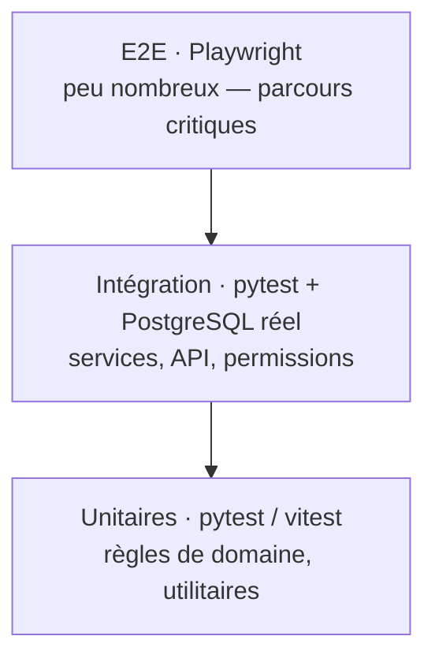

# 12 · Stratégie de tests et qualité

> 🟡 **Statut : M5 — à faire valider.**
> Pyramide de tests, environnements de test, types de tests, couverture,
> données de test, définition de « terminé », qualité du code (lint,
> typage, revue).

## 1. Pyramide de tests

*Figure 1 : la pyramide est volontairement plus épaisse au milieu — le
cœur du risque backend est la persistence et la sécurité, d'où une couche
d'intégration avec une **vraie base PostgreSQL**, pas un double simulé.*

## 2. Types de tests

| Type | Outil / cible | Portée | Exemples |
|---|---|---|---|
| Unitaire backend | pytest | règles métier pures | slug unique, `MAX_TREE_DEPTH`, transitions de workflow |
| Unitaire frontend / back-office | vitest | utilitaires et composants | conversion de slug, dates locales, complétude i18n |
| Intégration | pytest + PostgreSQL (conteneur éphémère, fixtures) | service / endpoint | CRUD contenus + versions, publication → cache + sitemap, FTS par langue |
| Contrat API automatisé (Point 8) | **Schemathesis** (Property-Based) + Spectral | chaque endpoint de `openapi.yaml` | Fuzzing exhaustif d'API : conformité stricte des schémas de réponse, absence de crash 500 sur entrées limites, respect des en-têtes obligatoires (`Idempotency-Key`), RFC 7807 (SC-141) |
| Autorisations | matrice générée (rôle × endpoint) | RBAC complet | l'éditeur ne publie pas, le client A ne lit pas le document de B (SC-510, SC-404) |
| Sécurité | pip-audit, trivy, tests ciblés | attaque simulée | XSS dans le contenu riche (SC-524), IDOR, brute force (SC-501) |
| E2E | Playwright (bureau + mobile) | parcours cœur | visite → recherche → contact ; édition → relecture → publication |
| Accessibilité | axe-core (Playwright) | pages publiques + back-office | contraste ≥ 4,5:1, navigation clavier, étiquettes de champs |
| Performance | k6 | lecture seule | P95 sous cible (page 11 §10) |
| Migration / parité | script dédié en CI | seed | `content.data.ts` ↔ base : 2/10/20/94 + slugs FR/EN (page 13) |

### 2.1 Tests de contrat d'API avec Schemathesis (Point 8 validé)

Pour dépasser la simple vérification syntaxique de Spectral et garantir que l'application FastAPI respecte son contrat en conditions réelles :
- **Outil** : `schemathesis` exécuté en test d'intégration via le runner ASGI in-memory (`--app app.main:app`), sans dépendance réseau.
- **Principe** : Fuzzing basé sur les propriétés (Hypothesis). Schemathesis génère automatiquement des centaines de requêtes aléatoires valides et limites pour chaque endpoint défini dans `openapi.yaml`.
- **Contrôles automatisés vérifiés** :
  1. `not_a_server_error` : aucune entrée, même malformée ou volumineuse, ne doit déclencher une erreur HTTP 500 inattendue.
  2. `status_code_conformance` : tous les codes de réponse renvoyés doivent être déclarés dans `openapi.yaml` (200, 202, 404, 409, 422, 429).
  3. `content_type_conformance` : les en-têtes `Content-Type` renvoyés doivent correspondre au schéma (`application/json` ou `application/problem+json`).
  4. `response_schema_conformance` : chaque payload de réponse doit valider rigoureusement le schéma JSON Schema de l'OpenAPI.

## 3. Environnements de test

- **CI** : conteneurs éphémères (PostgreSQL + fixtures) — aucun état
  persisté ; suites déterministes uniquement.
- **Pré-production** : copie **anonymisée** de production (personnes
  remplacées, fichiers d'essai), déploiement automatique sur `main`.
- **Performance / charge** : analysée en pré-production avant la mise en
  production (benchmarks k6 conclues dans le backlog, page 14).

## 4. Données de test

- Fixtures de seed de test **distinctes** du vrai contenu (aucun
  « Exemple » en production, RB-003) : contenus d'essai dans chaque
  langue, documents clients factices, leads fictifs.
- Chaque fixture porte dans son commentaire le `SC-` couvert
  (traçabilité directe avec la page 04).
- Interdiction de tester sur production, même pour une « simple
  vérification » ; tout passe par la pré-production.

## 5. Couverture

| Zone | Cible |
|---|---|
| Règles métier (services backend) | ≥ 90 % |
| Endpoints authentifiés (client, admin) | 100 % à travers la matrice de permissions |
| Écrans back-office | parcours vitaux automatisés (concurrente, workflow, publication) ; complément manuel |
| Pages publiques (accessibilité) | 0 violation axe-core bloquante |

La couverture est un moyen, pas une fin ; les zones sensibles en dehors
de la portée numérique (langue désactivée, draft exposé, IDOR) sont
connues et toujours testées.

## 6. « Terminé » (Definition of Done)

Une histoire est terminée seulement si :

1. code relu (co-revue, ou relecture différée à chaud quand l'équipe est
   seule — H-001) ;
2. tests écrits (au moins une intégration si un endpoint est touché) et
   verts en CI ;
3. documentation mise à jour (dictionnaire 06 si le modèle a changé,
   `openapi.yaml` si le contrat a changé) ;
4. permission créée/vérifiée dans la matrice (page 10) ;
5. aucun TODO sans ticket au backlog (page 14) ;
6. écran testé au clavier, contrastes vérifiés (ENF-401).

## 7. Qualité du code

- **Backend** : Python 3.13, `ruff` (format + lint), `mypy --strict`,
  SQLAlchemy 2.0 typé, Pydantic v2.
- **Frontend / back-office** : TypeScript strict, eslint, dépendances
  épinglées (`npm ci`), veille hebdomadaire (npm audit).
- **Revue** : tout changement de modèle (page 06) ou de contrat (page 08)
  exige la mise à jour simultanée des documents — la CI échoue sinon
  (test de cohérence des types générés).
- **Sécurité** : scans en CI bloquants sur les failles hautes
  (`pip-audit`, `npm audit`, trivy) ; version figée par fichiers de lock.

## 8. Traçabilité des tests

Chaque test nomme le scénario couvert, ex.
`test_sc523_publication_planifiee` ; la CI produit un rapport
scénario → nombre de tests → dernier pass (contrôle automatique du M6,
page 14 : aucune exigence MUST sans test).
