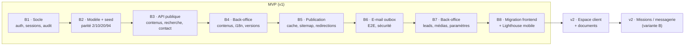

# 14 · Décisions, traçabilité, feuille de route

> 🟡 **Statut : M6 — à faire valider. Validation finale attendue avant
> toute ligne de code backend.**
> ADR consolidés, matrice de traçabilité complète (avec contrôle
> automatique), registre des risques, registres H-/Q- pour un
> non-technicien, feuille de route MVP, backlog « avant mise en
> production ».

## 1. ADR consolidés

| ADR | Décision | Statut | Page |
|---|---|---|---|
| ADR-001 | Traductions : une ligne par (entity_type, entity_id, lang), champs traduits en JSONB, invariants en colonnes (+ ADR-001 bis : sync `search_index` par trigger) | ✅ rédaction finale | 07 |
| ADR-002 | Arborescence : liste d'adjacence + CTE récursive, anti-cycles, `MAX_TREE_DEPTH=6` | ✅ | 06 |
| ADR-003 | Libellés d'interface dans le code ; e-mails = templates versionnés ; DB = contenu éditorial | ✅ | 07 |
| ADR-004 | Sessions cookies httpOnly + SameSite=Lax + CSRF ; rotation/révocation des sessions ; **MFA obligatoire** pour publier, exporter les leads, gérer les utilisateurs, accéder aux documents clients | ✅ | 09 |
| ADR-005 | Corps rédactionnels en Markdown **assaini** ; le reste des prestations/groupes/familles/domaines en données structurées | ✅ | 06, 14 §3 |
| ADR-006 | Recherche plein texte : table miroir `search_index` + config par langue | ✅ | 06, 07 |
| ADR-007 | Versionning du contrat API `/api/v1` ; coexistence `/v2` bornée | ✅ | 08 |
| ADR-008 | Back-office React + Vite + Tailwind (mutualisé frontend), pas d'admin générique | ✅ | 10 |
| ADR-009 | Topologie : **même origine via reverse proxy** (cookies `__Host-`, pas de CORS) | ✅ | 09 §2 |
| ADR-010 | Stockage fichiers : volume local + interface basculable (MinIO/S3 plus tard) | ✅ | 11 §7 |
| ADR-011 | Déploiement : Docker Compose sur un serveur unique (H-002), pas d'orchestrateur | ✅ | 11 |

## 2. Matrice de traçabilité (extraits — contrôle automatique, page 14 §5)

Chaque exigence MUST porte : UC (cas d'usage), SC (scénario), endpoint
(contrat), table(s), écran back-office (le cas échéant), test.

| Exigence | UC | SC | Endpoint | Tables | Écran | Test |
|---|---|---|---|---|---|---|
| EF-101 arborescence publique | UC-001 | SC-101 | `GET /services-tree` | content_nodes, translations | Arbre | E2E + parité |
| EF-201…204 recherche | UC-006 | SC-201…204 | `GET /search` | search_index | (aucun écran dédié) | fixtures FTS |
| EF-301…307 leads | UC-008…052 | SC-301…313 | `POST /contact`, `/admin/leads*` | leads, outbox | Leads | E2E + API |
| EF-401…405 espace client | UC-020…026 | SC-401…410 | `/client/**` | client_*, sessions | Clients | security + E2E |
| EF-501…514 back-office éd. | UC-030…043 | SC-520…571 | `/admin/**` | users, sessions, versions | Éditeur | matrice + API |
| EF-601…605 multi-langue | UC-6x | SC-601…606 | *transversal* | languages, translations | Langues | API + UI |
| EF-701…704 SEO/sitemap | — | SC-140, 701…704 | `sitemap.xml`, `/redirects` | redirects | SEO | test sitemap |
| EF-801…803 médias | UC-042 | SC-540…542, 801, 802 | `/admin/media*` | medias, media_refs | Médiathèque | sécurité |
| EF-901…903 audit/santé | UC-046, 045 | SC-550, 511 | `/admin/audit`, healthchecks | audit_log | Audit/Santé | intégration |
| EF-1001…1004 conformité | UC-026 | SC-1001…1004 | `/client/data-request` | consents | — | processes rev |

## 3. Contrôle automatique de traçabilité

Exécuté en CI (script `scripts/check-trace.py`) : parse les pages 02
(exigences) et 04 (scénarios) ;
**toute exigence `MUST` doit avoir au moins un SC et un test associé,
sinon la CI échoue**. Complète le contrôle des types générés par OpenAPI
(page 12 §7) : une exigence « sans scénario » bloque la mise en prod
exactement comme un test rouge.

## 4. Registre des risques

| ID | Risque | Probabilité | Impact | Mitigation | Scénario |
|---|---|---|---|---|---|
| R-01 | Effectif mono-personne (H-001) : indisponibilité du fondateur | moyenne | haut | runbooks écrits (page 11 §12), sauvegardes testées, pas de process opaque | SC-511 |
| R-02 | Contenus légaux non validés à la mise en ligne | élevée | moyen (conformité) | bloqueur RB-001 : bandeau « à compléter » jusqu'à validation | SC-112 |
| R-03 | Dérive frontend ↔ API (contrat en double) | moyenne | moyen | types générés d'OpenAPI, un seul contrat (ADR-007), CI de cohérence | page 12 §7 |
| R-04 | Edition de slug/tour d'URL malencontreuse | moyenne | moyen UX/SEO | prévisualisation + redirection auto (US-005, SC-530) | SC-530 |
| R-05 | Perte du second facteur (MFA) par le fondateur (perte du téléphone) | basse | bloque l'administration — | codes de récupération 10×, régénérables après reconnexion | page 09 §2 |
| R-06 | Données personnelles en production copiées en pre-prod | basse | élevé (conformité) | copie **anonymisée** obligatoire (page 12 §3) | page 12 |
| R-07 | Montée d'audience non prévue (le contenu viralise au Sénégal) | basse | moyen | cache + VPS ajustable, plan de reprise | page 11 §10 |
| R-08 | LanguageTool/outils publics instables (retour constaté) | certain | mineur | relecture locale (pyspellchecker) — pas de dépendance runtime | — |

## 5. Registre H- (pour le cabinet, formulées lisibles)

| ID | Hypothèse | Défaut retenu | Qui peut changer d'avis |
|---|---|---|---|
| H-001 | Le fondateur est seul au départ ; le système prévoit plusieurs utilisateurs et rôles | modélisation complète v1 | à chaque recrue |
| H-002 | Pas d'abonnement SaaS (auto-hébergé Debian + Docker) | retenu | réservé en cas de problème d'hébergement (Q-008) |
| H-005 | Pas de newsletter en v1 | hors périmètre | à tout moment (l'ajouter = un module de plus) |
| H-006 | `contact@exauceac.com` est l'expéditeur réel | retenu (SMTP à configurer) | paramètres du back-office |
| H-007 | Pages légales servies avec bandeau tant que non validées | bloqueur RB-001 | cabinet/juriste |
| H-009 | Sans équivalent de langue, on garde le parent de rubrique (pas de 404) | retenu | jamais (comportement de repli) |
| H-010 | Une traduction ne peut être publiée que si la langue par défaut est « approuvée » | recommandé | le cabinet |
| H-011 | Pas de mesure d'audience tierce en v1 (compteurs simples seulement) | retenu | à la découverte de statistiques possibles |

## 6. Registre Q- (questions ouvertes — recommandation par défaut)

| ID | Question (formulée non-technique) | Recommandation par défaut |
|---|---|---|
| Q-001 | doit-on être conforme au RGPD en plus de la loi sénégalaise ? | oui si des clients européens ; à valider juridiquement |
| Q-002 | la page « Tarifs » doit-elle exister (le frontend actuel n'en pas) ? | non, une page « Travailler avec nous » à la place — question à trancher |
| Q-004 | newsletter : jamais, plus tard, ou en v1 ? | plus tard (hors MVP) |
| Q-007 | capcha sur le formulaire ? | non en v1 (détection douceur : honeypot + délai) |
| Q-008 | hébergeons-nous au Sénégal ou en Europe ? | Sénégal (production) + sauvegardes ailleurs (page 11 §11) |
| Q-010 | moteur de recherche : déclencheurs transactionnels ou files d'attente ? | déclencheurs (simple, sûr) |
| Q-011 | e-mail via relais spécialisé ou directement le serveur ? | relais spécialisé (délivrabilité) |
| Q-005 / Q-003 | aspects rédactionnels/details du fichier docx | suivre le docx à la lettre |

## 7. Feuille de route (jalons de construction, à proposer après validation)

*Figure 1 : jalons de construction — chaque jalon a des critères de
sortie mesurables ; les durées réelles seront chiffrées au moment du
chiffrage, avec le fondateur.*

Critères de sortie MVP :
- tous les MUST (EF/ENF) testés et verts ;
- seed de parité 2/10/20/94 en CI (SC-580) ;
- parcours visite → contact E2E (SC-101, SC-301) ;
- publication complète depuis le back-office sans intervention technique.

*Les durées sont indicatives ; un calendrier réel sera proposé avec le
procédure de construction, à négocier avec la disponibilité du fondateur.*

## 8. Backlog « avant mise en production »

| # | Élément | Référence |
|---|---|---|
| 1 | Pages légales validées (mentions, confidentialité, cookies) | RB-001, H-007 |
| 2 | Adresse postale réelle renseignée | RB-002 |
| 3 | Suppression des contenus « Exemple » du seed et remplacement par le contenu réel | RB-003 |
| 4 | Lighthouse mobile < 80 (performance + accessibilité) | page 11 §10 |
| 5 | Test de restauration complet répété et validé | SC-511 |
| 6 | SPF/DKIM/DMARC vérifiés (test d'e-mail réel) | page 11 §8 |
| 7 | Scan de sécurité (OWASP ZAP light) en pré-production | page 12 §2 |
| 8 | Copie anonymisée en pré-production vérifiée | page 12 §3 |
| 9 | Mot de passe/MFA du fondateur initialisés + codes de récupération | page 09 §2 |
| 10 | Sitemap comparé avant/après bascule (aucune URL perdue) | page 13 §6 |
