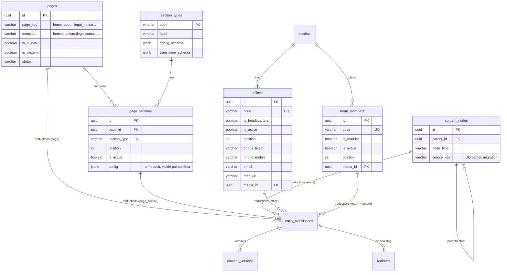

# 16 · Modèle éditorial cible — contenu intégralement éditable

> 🟡 **Statut : M2 — à faire valider.**
> Réponse à la décision de périmètre : **tout le contenu textuel public est
> éditable depuis le back-office**, à l'exception explicite des libellés
> d'interface génériques et des messages techniques. Cette page définit les
> tables ajoutées ou modifiées, justifie chaque choix et fournit les
> alternatives écartées. L'inventaire clé par clé est en
> [15 · Inventaire du contenu](15-inventaire-contenu.md).

## 1. Trois registres de texte (règle de tri)

| Registre | Où vit le texte | Éditable en back-office ? | Exemples |
|---|---|---|---|
| **Éditorial** | Base PostgreSQL (`entity_translations`, `site_settings`) | ✅ oui, avec workflow, versions, permissions par langue | titres de pages, textes de sections, prestations, secteurs, publications, bureaux, équipe, SEO, mentions légales, libellés de statistiques, CTA, texte du bandeau cookies |
| **Interface (UI)** | Fichiers i18n du code (`fr.json`, `en.json`) | ❌ non — exception assumée (ADR-003) | « Rechercher », « Fermer », « Menu », « En savoir plus » *lorsqu'il s'agit d'un contrôle générique*, libellés de formulaires, états de chargement/erreur, navigation clavier, `aria-*` |
| **Technique** | Code backend / templates versionnés | ❌ non | messages d'erreur API, messages de validation, e-mails transactionnels, codes HTTP |

La frontière est volontairement **matérialisée par une liste fermée** :

- les clés classées **UI** ou **technique** restent dans les fichiers i18n ;
- toutes les autres passent en base et sont listées dans le document 15 ;
- toute nouvelle clé éditoriale doit être ajoutée au modèle (section typée ou
  table) — jamais codée en dur.

> **Point de vigilance** : les CTA partagés (« Contactez-nous », « Nos
> services », « En savoir plus », « Découvrir ») sont utilisés à plusieurs
> endroits. Ils sont traités comme du **micro-texte éditorial partagé** dans
> `site_settings` (groupe `ui_copy`), et non comme des libellés UI, afin que
> le cabinet puisse les modifier sans release. Les contrôles purement
> fonctionnels (recherche, fermeture, menu) restent en i18n.

## 2. Vue d'ensemble du modèle

*Figure 1 : le couple `pages` + `page_sections` remplace le codage en dur des
sections d'accueil et des pages éditoriales ; `offices` et `team_members`
portent les données aujourd'hui absentes ou implicites.*

## 3. `page_sections` + `section_types` — blocs typés

### 3.1 Pourquoi des blocs typés

L'accueil actuel enchaîne **neuf sections hétérogènes** (hero, bandeau de
confiance, à-propos, domaines, audit, interventions, secteurs, chiffres,
publications, CTA). Chaque section a des champs différents :

| Section | Champs éditoriaux | Champs de configuration |
|---|---|---|
| `hero` | 2 lignes de marque, sous-titre, libellés CTA | variante, média de fond |
| `trust_bar` | 4 textes de référence | 4 icônes |
| `about_preview` | kicker, titre, texte, libellé CTA | page liée, média |
| `domains_grid` | kicker, titre | limite, famille |
| `audit_grid` | kicker, titre, texte | famille |
| `interventions_grid` | kicker, titre | limite |
| `sectors_grid` | kicker, titre | limite |
| `stats` | kicker, 4 libellés | sources de valeur (comptage/manuel) |
| `publications_grid` | kicker, titre, libellé « tout voir », texte vide | limite |
| `cta` | titre, texte, libellé secondaire | cible, variante |
| `rich_text` | corps Markdown | largeur |
| `values_grid` | titre, items | nombre de colonnes |
| `steps` | titre, items | variante |
| `founder_card` | titre, texte de repli | membre lié |
| `contact_form` | intro, texte de succès | champs actifs |
| `offices_grid` | titre, intro | bureau mis en avant |
| `legal_document` | corps Markdown, texte du bandeau | niveau de complétude |

Une table unique de colonnes serait soit **très large et majoritairement
vide**, soit **une table par type** (17 tables) avec des migrations à chaque
nouveau bloc. Les blocs typés évitent les deux écueils.

### 3.2 Décision

- `section_types` : **registre** des types autorisés. Chaque ligne porte un
  `config_schema` (JSON Schema 2020-12) pour les champs non traduits et un
  `translation_schema` pour les champs traduits. Un type inconnu ne peut pas
  être instancié (FK).
- `page_sections` : **instance** d'un bloc sur une page, avec `source_key`
  (clé stable du bloc, ex. `mentions`, `hero`), `position`, `is_active` et
  `config JSONB`. Les textes ne sont **jamais** dans `config` :
  ils sont dans `entity_translations` (`entity_type='page_section'`), ce qui
  conserve le workflow, les versions, les permissions par langue et le repli
  `is_fallback`.
- `pages` : chaque page publique est une ligne (`page_key` stable), soit
  `home`, `services`, `interventions`, `sectors`, `publications`, `about`,
  `locations`, `legal_notice`, `contact`, `client_area`, `not_found`
  (**11 pages**). Le frontend actuel ne sert qu'**une** URL légale : les
  mentions, la confidentialité et les cookies sont **trois sections**
  `legal_document` de `legal_notice`, pas trois pages. Éclater ces textes en
  trois URLs indexables reste une option (Q-102, doc 13). Les pages
  « système » ne sont pas supprimables (`is_system=true`).
- Ordre : `position` entier, `UNIQUE (page_id, position) DEFERRABLE INITIALLY
  DEFERRED` pour permettre les réordonnancements en une transaction.

### 3.3 Alternatives examinées

| Option | Avantages | Inconvénients | Verdict |
|---|---|---|---|
| **A1 · une table par type de section** | typage SQL fort, FK par champ | 17 tables, migrations à chaque variante, impossible de réordonner des types différents sans UNION, duplication des colonnes `position/is_active` | écartée |
| **A2 · un seul champ `pages.body` Markdown** | simple, une colonne | perd les composants structurés (grille de domaines, chiffres, cartes), responsive et accessibilité non garantis, non réutilisable | écartée |
| **A3 · `pages.layout JSONB`** | une seule table, très souple | pas de workflow par bloc, pas de validation par type, pas de versions ciblées, requêtes et back-office difficiles | écartée |
| **B · `page_sections` + `section_types` (retenue)** | typage par schéma, réordonnancement, activation, traduction et versions par bloc, ajout d'un type sans migration de schéma | une table de registre + une table d'instances ; validation applicative du JSONB | **retenue** |

### 3.4 Catalogue initial de `section_types`

Le catalogue est **technique** (il ne s'édite pas comme du contenu) ; ses
libellés sont en i18n back-office. Il est semé par migration et peut être
étendu par une nouvelle ligne + un composant frontend.

| Code | Usage | Champs traduits (indicatifs) |
|---|---|---|
| `hero` | accueil | `brand_line1`, `brand_line2`, `subtitle`, `primary_cta`, `secondary_cta` |
| `trust_bar` | accueil | `items[].text` (4) |
| `about_preview` | accueil | `kicker`, `title`, `text`, `cta_label` |
| `domains_grid` | accueil, services | `kicker`, `title` |
| `audit_grid` | accueil, services | `kicker`, `title`, `text` |
| `interventions_grid` | accueil | `kicker`, `title` |
| `sectors_grid` | accueil | `kicker`, `title` |
| `stats` | accueil | `kicker`, `items[].label` (4) |
| `publications_grid` | accueil | `kicker`, `title`, `cta_label`, `empty_text` |
| `cta` | transverse | `title`, `text`, `secondary_label` |
| `page_header` | pages internes | `kicker`, `title`, `intro` |
| `modes` | services | `title`, `items[].title`, `items[].text` |
| `values_grid` | à propos | `title`, `empty_text`, `items[].title`, `items[].text` |
| `steps` | à propos | `kicker`, `items[].title`, `items[].text` |
| `founder_card` | accueil, à propos | `kicker`, `empty_text` |
| `interventions_compare` | interventions | `title`, `head_label`, `caption`, `rows[].label`, `rows[].recurring`, `rows[].oneoff` |
| `contact_form` | contact | `intro`, `success_text` |
| `offices_grid` | localisations | `title`, `intro`, `empty_text` |
| `legal_document` | mentions, confidentialité, cookies | `body`, `banner_text` |
| `coming_soon` | espace client | `title`, `text`, `cta_label` |

*Les schémas exacts sont versionnés dans `section_types.config_schema` et
`section_types.translation_schema` (migration initiale), puis figés par les
tests de contrat du back-office.*

## 4. `offices` — bureaux et localisations

### 4.1 Pourquoi une table dédiée

La page « Localisations » et le pied de page affichent aujourd'hui des
placeholders. Les coordonnées sont dans `ORGANIZATION` (frontend), avec **un
seul** point de contact. Or :

- le cabinet peut ouvrir plusieurs bureaux (Dakar, autre région, etc.) ;
- chaque bureau a sa propre adresse, ses téléphones, son e-mail, sa carte,
  éventuellement une photo et des horaires ;
- chaque bureau doit être traduit FR/EN et activable/désactivable ;
- le bureau « siège » doit être identifiable pour le contact et le footer.

Un tableau JSONB dans `site_settings` ne permet ni l'ordre, ni l'activation,
ni la traduction par bureau, ni les références média. Une table dédiée est
donc justifiée.

### 4.2 Structure

`offices(id, code UQ, is_headquarters, is_active, position, phone_fixed,
phone_mobile, email, map_url, media_id FK, created_at, updated_at)`.

Traductions (`entity_type='office'`) : `name`, `address_lines[]`, `city`,
`region`, `hours`, `notes`, `photo_alt`.

Règle : **un seul** `is_headquarters=true` (index partiel) ; le contact
public utilise le siège par défaut, le footer aussi. Si aucun bureau n'est
actif, le frontend affiche le texte de repli de la section (`empty_text`).

### 4.3 Alternative

| Option | Verdict |
|---|---|
| `site_settings` groupe `contact` (adresse unique) | conservée pour l'identité globale (nom légal, e-mail générique, réseaux), insuffisante pour plusieurs bureaux |
| `offices` (retenue) | ordre, activation, traduction, média, siège, réutilisation contact/footer/localisations |

## 5. `team_members` — fondateur et équipe

La photo, le nom, le rôle et la biographie du fondateur sont aujourd'hui des
placeholders ou des clés i18n. Ils doivent être éditables et réutilisables
sur l'accueil et la page « À propos ».

`team_members(id, code UQ, is_founder, is_active, position, media_id FK,
email, linkedin_url, created_at, updated_at)`.

Traductions (`entity_type='team_member'`) : `full_name`, `role`, `bio`,
`photo_alt`.

Alternative : stocker le fondateur dans la section `founder_card` (config +
texte). Cela marche pour un seul fondateur mais ne permet pas d'ajouter un
membre, de réutiliser la fiche, ni de gérer la photo comme un média référencé.
La table est retenue ; la section `founder_card` ne porte que le texte
d'introduction et le lien vers le membre `is_founder=true`.

## 6. `content_nodes.source_key` — clé de migration

Chaque nœud de l'arborescence existe aujourd'hui avec un `id` stable dans
`content.data.ts` (`accompagnement`, `audit-externe`, `systeme-information`,
`application-logicielle`…). La migration doit être **idempotente** et
**réversible**.

`content_nodes.source_key VARCHAR(80) NULL` + index unique partiel
`WHERE source_key IS NOT NULL`.

- Clé de rapprochement du seed : réexécution = mise à jour, pas de doublon.
- Traçabilité des 126 nœuds (2 + 10 + 20 + 94) et des publications d'exemple.
- Conservée après migration (au moins jusqu'à validation), puis purgeable par
  une migration dédiée.
- **Alternative écartée** : rapprochement par slug FR — fragile dès qu'un
  slug est édité ; par chemin — fragile lors d'un déplacement.

`publications.legacy_key` est renommé `source_key` pour une convention unique
(ou conservé avec un commentaire de compatibilité ; décision de nommage à
valider, sans impact fonctionnel).

## 7. Slugs des prestations — identifiant + URL stable

### 7.1 Règle

Chaque nœud `service` (prestation) reçoit :

- un `id UUID` (comme tous les nœuds) ;
- un `slug` par langue dans `entity_translations`, **unique** par
  `(entity_type='node', lang)`.

Algorithme de génération à partir du libellé FR :

1. normalisation Unicode NFD, suppression des diacritiques, minuscules,
   remplacement de tout caractère non `[a-z0-9]` par `-`, compression des
   tirets, trim, troncature à 80 caractères ;
2. si le slug est libre → retenu ;
3. sinon, contextualisation par le **groupe parent** :
   `slug(base) + '-' + slug(groupe)` ;
4. si encore pris, contextualisation par le **domaine parent** ;
5. en dernier recours, suffixe numérique `-2`, `-3`… ;
6. longueur finale ≤ 120 caractères ; jamais de slug vide pour une entité
   publiée.

### 7.2 Doublons constatés dans le contenu actuel

| Libellé FR | Occurrences | Stratégie |
|---|---|---|
| `Formation des dirigeants et employés` | **13** | `formation-des-dirigeants-et-employes-<slug-du-groupe>` (13 groupes distincts) |
| `Formation des administrateurs et dirigeants` | **2** | groupe parent distinct (`strategie-intra-entreprise`, `organisation-structurelle-fonctionnelle`) |
| `Formation des administrateurs, dirigeants et employés` | **2** | groupe parent distinct (`fonction-audit-interne`, `systeme-controle-interne`) |

La liste exhaustive des 13 occurrences figure dans le document 15 (§4).

### 7.3 Traduction et modification

- Le slug EN est généré depuis le libellé EN, avec la même algorithme ; il
  peut être édité indépendamment.
- Toute modification crée une ligne dans `redirects` (301) de l'ancien chemin
  vers le nouveau, dans la langue concernée.
- Un slug peut être identique entre FR et EN (ex. `public`, `contact`) ;
  l'unicité est par langue.

### 7.4 Question ouverte : URL d'une prestation

Deux cibles sont possibles :

| Option | URL | Avantages | Coûts |
|---|---|---|---|
| **S1 · ancre stable** | `/{lang}/services/{famille}/{domaine}#{groupe}/{prestation}` | aucun nouveau gabarit ; deep-link et recherche fonctionnent | un fragment n'est **pas** envoyé au serveur : une redirection HTTP 301 sur changement de slug est impossible ; le slug ne sert qu'au deep-link |
| **S2 · page prestation dédiée** | `/{lang}/services/{famille}/{domaine}/{groupe}/{prestation}` | URL indexable, 301 possible, SEO par prestation, partage propre | 94 pages supplémentaires (×2 langues), nouveau gabarit, plus de maillage et de tests |

La demande « slug unique + redirection automatique » n'est **pleinement
cohérente qu'avec S2**. S1 reste acceptable si le slug est compris comme un
identifiant de deep-link, sans promesse de redirection. **Décision à
prendre** (Q-101, document 18). Le modèle de données est identique dans les
deux cas ; seule l'exposition des routes change.

## 8. SEO — où vivent les métadonnées

- `seo_title`, `seo_description` : champs traduits dans
  `entity_translations.data`, pour chaque entité qui a une URL (page, nœud,
  publication, catégorie, secteur, type d'intervention).
- `og_media_id UUID FK medias NULL` : **nouvelle colonne** sur
  `entity_translations`, pour une image OG par entité × langue (sinon repli
  sur l'image OG globale de `site_settings`).
- `site_settings` groupe `seo` : `default_og_media_id`, `robots_default`,
  `sitemap_enabled`, `organization_jsonld` (nom légal, logo, réseaux).
- Longueurs validées : `seo_title` ≤ 60, `seo_description` ≤ 160
  (avertissement, pas blocage dur ; EF-703).
- Le rendu (prérendu au build ou SSR) est traité séparément dans
  [17 · SEO et rendu](17-seo-rendu.md) — **deux options chiffrées, aucune
  décision unilatérale**.

La classe `PageSeoMeta` du document 05 est ainsi réalisée par
`entity_translations` + `og_media_id`, sans table jumelle.

## 9. Réglages et micro-texte (`site_settings`)

Groupes semés :

| `group_key` | Contenu | Traduisible |
|---|---|---|
| `identity` | nom légal, nom commercial, tagline footer, logo | oui (tagline) |
| `contact` | e-mail générique, réseaux sociaux, préférence de contact | partiellement |
| `seo` | OG par défaut, robots, JSON-LD | non / partiel |
| `cookies` | message du bandeau, libellés des boutons, texte « personnaliser » | oui |
| `ui_copy` | CTA partagés (`cta_contact`, `cta_services`, `cta_learn_more`, `cta_discover`, `cta_back_home`) | oui |
| `retention` | durées leads, audits, consentements | non |
| `features` | modules actifs (espace client, recherche, cookie banner) | non |

Chaque valeur traduisible est stockée dans `entity_translations`
(`entity_type='setting'`) avec `data = {"value": "..."}`. Les valeurs non
traduites restent dans `site_settings.value JSONB`.

> **Ne pas confondre** : les libellés de formulaire, les messages de
> validation et les états de chargement restent en i18n (UI/technique). Le
> bandeau cookies, lui, est du texte légal public : il est éditorial.

## 10. Contenu partagé entre pages (cas « À propos »)

Le texte d'introduction de la page « À propos » est aujourd'hui réutilisé
dans la section d'accueil (`home.aboutText`). Trois options :

| Option | Principe | Verdict |
|---|---|---|
| **D1 · duplication seedée** | deux champs distincts, même valeur initiale | simple ; risque de divergence si le client n'édite qu'un côté. Retenue pour la v1, avec un avertissement dans le back-office. |
| **D2 · `content_ref`** | la section `about_preview` référence `page:about:intro` ; l'API résout la référence | source unique ; complexité de résolution, de cache et de version. Alternative recommandée si la divergence devient un problème. |
| **D3 · fragment partagé** | table `content_fragments` réutilisable | puissant mais surdimensionné pour un seul cas. Écartée. |

## 11. Impact sur les tables existantes

| Table | Changement |
|---|---|
| `pages` | + `template`, `is_in_nav`, `nav_position`, `is_system`, `source_key` ; `page_key` devient un registre fermé |
| `entity_translations` | + `og_media_id` ; CHECK `entity_type` étendu (`page_section`, `office`, `team_member`) ; `data` peut contenir `seo_title`, `seo_description`, `nav_label`, `body`, `items[]` |
| `content_nodes` | + `source_key` (UQ partiel) |
| `redirects` | devient la **table unique** des redirections ; absorbe l'ancienne `slug_redirections` (colonnes `entity_type`, `entity_id`, `lang`, `old_path`, `target_path`, `status_code`) |
| `site_settings` | nouveaux groupes `identity`, `cookies`, `ui_copy`, `features` ; `is_translatable` conservé |
| `section_types` | nouvelle table de registre |
| `page_sections` | nouvelle table d'instances |
| `offices` | nouvelle table |
| `team_members` | nouvelle table |

## 12. Alternatives de portage (synthèse)

| Sujet | Retenu | Alternative principale | Raison |
|---|---|---|---|
| Blocs de page | `page_sections` + `section_types` | une table par type / Markdown | compromis typage / évolutivité |
| Bureaux | `offices` | JSONB dans `site_settings` | multi-sites, média, ordre |
| Équipe | `team_members` | champs dans `page_sections` | réutilisation accueil / à propos |
| Migration | `source_key` | slug / chemin | robustesse aux renommages |
| SEO | `entity_translations` + `og_media_id` | table `seo_metadata` | pas de duplication du cycle de vie |
| Slugs prestations | contexte groupe puis domaine | suffixe numérique seul | lisibilité et SEO |
| Micro-texte CTA | `site_settings.ui_copy` | libellés par section | cohérence et édition centralisée |

## 13. Ce que cette page ne tranche pas

Les points suivants sont volontairement renvoyés au document
[18 · Questions ouvertes](18-questions-ouvertes.md) : URL des prestations
(S1/S2), rendu SEO (prérendu/SSR), nombre et adresses des bureaux, photo et
biographie du fondateur, liste exacte des types de sections, statut éditable
ou non de la page 404 et de l'espace client, et niveau de liberté laissé au
client sur les valeurs des statistiques.
